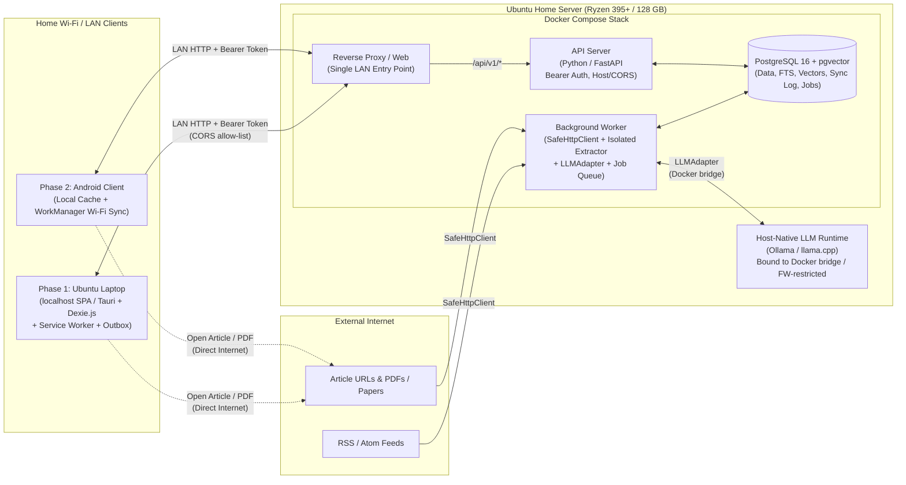

# System Architecture

> **Status:** In Review *(Revised after 2026-11-22 design reviews; ready for owner approval)*

## 1. High-Level Overview
SmartRSS uses a **containerized home-LAN backend** paired with **local-first clients** that run from a stable secure origin (`localhost` on Ubuntu laptops in Phase 1; native/Capacitor shell on Android in Phase 2), cache curated items/metadata locally, and queue offline mutations when detached from the home network.

All client traffic enters through a **single LAN reverse-proxy entry point** (`web`, which serves the connected SPA fallback and reverse-proxies `/api/` to `api`). Outbound server fetches pass through a shared SSRF-hardened `SafeHttpClient`, and untrusted HTML/PDF parsing runs inside a resource-bounded subprocess. The local LLM runtime (`Ollama` or `llama.cpp`) runs natively on the Ubuntu host—restricted to the Docker bridge / firewall allow-list—to leverage Ryzen AI Max+ 395 unified-memory acceleration cleanly.

## 2. Tech Stack & Rationale

| Layer | Choice | Rationale |
| :--- | :--- | :--- |
| **API Server** | Python 3.12+ / FastAPI / Pydantic v2 / SQLAlchemy + Alembic | Strong typing, OpenAPI contract generation for Web and Android clients, reversible SQL migrations. |
| **Background Worker** | Python async worker + PostgreSQL `SKIP LOCKED` queue | Reuses domain models/DB layer; eliminates Redis/Celery overhead while supporting dedupe keys, leases, priorities, advisory-lock scheduling, and dead-letter inspection ([ADR 0003](decisions/0003-postgres-backed-job-queue-and-async-llm-pipeline.md)). |
| **Safe Fetching & Extraction** | Shared `SafeHttpClient` (`httpx` + DNS/IP pinning), `feedparser`, `trafilatura`, `pymupdf` in bounded subprocess | Protects the home LAN from SSRF across all fetchers and isolates C-level PDF/HTML parsers from crashing or exhausting the worker ([ADR 0006](decisions/0006-lan-security-ssrf-and-content-isolation.md)). |
| **Database & Search** | PostgreSQL 16+ with `pgvector` and `tsvector` FTS | Single containerized datastore for relational state, commit-ordered `sync_changes` log, full-text search, versioned vector embeddings, and job queue ([ADR 0001](decisions/0001-tech-stack-and-container-topology.md), [ADR 0004](decisions/0004-sync-watermark-aggregates-and-restore-epoch.md)). |
| **Local LLM Adapter** | Internal `LLMAdapter` with runtime capability profiles (`Ollama` & `llama.cpp`) | Handles runtime differences in structured JSON-schema output (`format` vs `response_format`/GBNF), reasoning-model `<think>` output, and embedding batching/normalization rather than assuming uniform OpenAI compatibility. |
| **Phase 1 Client (Ubuntu Laptop)** | React + TypeScript (`strict: true`) + Vite + **Dexie.js** + **DOMPurify**, served from fixed `localhost` origin (local runner or Tauri shell) | Guarantees a secure context for Service Workers and `navigator.storage.persist()` when the laptop leaves the LAN, avoids LAN CA/cert friction, and prevents XSS ([ADR 0005](decisions/0005-phase1-client-origin-and-offline-shell.md)). |
| **Phase 2 Client (Android)** | Capacitor (native HTTP plugin) or native Kotlin consuming `/api/v1/sync/*` | Handles Android 9+ cleartext `networkSecurityConfig`, avoids WebView mixed-content blocks, and enables `WorkManager` background sync on home Wi-Fi ([ADR 0002](decisions/0002-native-sync-api-and-detached-client-model.md)). |
| **Packaging** | Docker Compose (`web`, `api`, `worker`, `db`) | Reproducible Ubuntu homelab deployment through a single LAN entry point. |

## 3. Components & Responsibilities

### 3.1 Reverse Proxy / Web (`web`)
- Single exposed LAN entry point (e.g., port `8080`).
- Reverse-proxies `/api/` to `api` (preserving `Host` and forwarding client headers) and serves the static SPA bundle with strict security headers (`Content-Security-Policy`, `X-Content-Type-Options: nosniff`, `Referrer-Policy: no-referrer`).

### 3.2 API Server (`api`)
- Exposes versioned REST/JSON endpoints (`/api/v1/...`).
- **Security Middleware**: Enforces `Host` allow-list, strict CORS allow-list, JSON-only mutation `Content-Type`, and per-device `Authorization: Bearer <token>` validation on all routes except `/api/v1/health` and `/api/v1/auth/pair`.
- **Device Pairing**: CLI-bootstrapped (and paired-device UI/QR) one-time pairing codes exchanged for individually revocable per-device bearer tokens.
- **Sync Endpoints** ([ADR 0004](decisions/0004-sync-watermark-aggregates-and-restore-epoch.md)):
  - `GET /api/v1/sync/bootstrap`: Returns active working set + `watermark` + `instance_epoch`.
  - `GET /api/v1/sync/pull?since_seq=<N>&limit=<K>`: Returns strictly commit-ordered aggregate upserts & tombstones from `sync_changes`, plus `watermark` and `instance_epoch`.
  - `POST /api/v1/sync/push`: Applies idempotent client mutations (`client_mutation_id`), returning per-mutation `{status: applied|superseded|rejected, reason?, server_state?}`.
- **Interactive / Management Endpoints**: Feed CRUD (online-only add/OPML), Feed Health, server-side full-archive FTS search, versioned prompt/Interest Profile editor, manual re-process / on-demand mini-research trigger, and System Health / dead-letter queue management.

### 3.3 Background Worker (`worker`)
Uses PostgreSQL advisory locks (`pg_try_advisory_lock`) for singleton scheduler leadership and `SKIP LOCKED` with lease heartbeats for job execution across six idempotent stages:
1. **Feed Poller (`poll_feed`)**: Uses `SafeHttpClient`, conditional HTTP (`ETag`, `Last-Modified`), `304`/`301`/`410`/`429` (`Retry-After`), jitter, and exponential backoff; enforces backfill cap (`N = 10` default) on newly subscribed feeds; separates `status` (user intent) from `health_state`.
2. **Isolated Content Extractor (`extract_content`)**: Fetches full linked HTML via `SafeHttpClient` (with per-domain rate limiting) and extracts text (`trafilatura`) inside a resource-bounded subprocess (CPU, RAM, wall-clock caps); falls back cleanly to RSS summary on block/error.
3. **Pre-Enrichment Dedup & Story Clusterer (`cluster_item`)**: Runs **before** LLM enrichment to avoid redundant LLM calls on exact duplicates. Matches exact `canonical_url` first, then computes a normalized embedding (`title + lead_excerpt`) using the active embedding model and queries active in-window clusters via `pgvector`. Assigns cluster membership (and records a `sync_changes` event).
4. **Mini-Research Fetcher (`mini_research`)**: Triggered by per-feed `research_policy`, primary-source link heuristics (PDF/arXiv/report links), or explicit user request ("dig deeper"). Fetches primary sources via `SafeHttpClient` within strict guardrails (default 1 hop, 20 MB PDF / 5 MB HTML, max 50 pages, timeout) and extracts text (`pymupdf` / `trafilatura`) inside the isolated extraction subprocess.
5. **Cluster-Aware LLM Enricher (`enrich_item`)**: Acquires the global LLM concurrency slot (`concurrency = 1`), builds a token-budgeted, prompt-injection-delimited prompt (system rubric + active Interest Profile + bounded diverse feedback examples + per-feed hint + article text + mini-research excerpts), calls `LLMAdapter`, validates structured JSON output via Pydantic (5 calibrated relevance tiers, rationale, TL;DR, takeaways, tags, depth, research context), updates `search_vector`, and emits an aggregate `item` upsert in `sync_changes`.
6. **Maintenance Schedulers**: `expire_items` (marks unread unstarred items past effective TTL based on `fetched_at` as `expired`), stale-lease job reaper, and retention cleanup (`jobs` > 30 days, `sync_mutations` & `sync_changes` > 90 days).

### 3.4 Local-First Client (`localhost` Ubuntu Phase 1 & Phase 2 Android)
- Runs from a stable `localhost` secure origin (Phase 1) with `navigator.storage.persist()` requested on startup and a Service Worker caching the app shell for offline launch.
- Stores feeds, categories, active profile/settings, unread + starred items, and last 14 days of read items in IndexedDB (`Dexie.js`); evicts older read/expired unstarred items locally.
- Supports **detached local search** over cached working-set fields, **sortable tables/lists**, **DOMPurify** sanitization + strict CSP, and a persistent **offline mutation outbox** with rejection rollback & notification UX.
- Opens external article and PDF URLs directly in the user's browser over the client's internet connection.

## 4. Key Data Flows

### 4.1 Ingestion → Pre-Enrichment Clustering → Mini-Research → Enrichment
1. **Scheduler** dispatches `poll_feed` when `next_fetch_at <= now()`.
2. **`poll_feed`** ingests new entries (applying backfill cap on initial poll), commits `items` + `sync_changes` (so items appear immediately in clients as `pending` enrichment), and enqueues `extract_content`.
3. **`extract_content`** extracts clean article text in an isolated subprocess, updates `search_vector`, and enqueues `cluster_item`.
4. **`cluster_item`** matches exact `canonical_url` duplicates or computes the canonical `title + lead_excerpt` embedding and assigns/creates a cluster.
   - If the item is an **exact canonical-URL duplicate** of an already-enriched item in the cluster, it links to the cluster and optionally skips redundant LLM synthesis (marking enrichment `inherited` / referencing primary context) unless distinct commentary exists.
   - Otherwise, enqueues `mini_research` (if triggered by feed policy/heuristics) or directly `enrich_item`.
5. **`mini_research`** fetches & extracts primary source(s) in the isolated subprocess, persists `research_sources`, and enqueues `enrich_item`.
6. **`enrich_item`** runs `LLMAdapter` under the concurrency-1 slot, validates structured JSON, persists `item_enrichments` + LLM `item_tags`, updates `search_vector` and cluster representative/tier, and records an `item` upsert in `sync_changes`.

### 4.2 Detached Reading, Reconnect Sync & Restore Recovery
1. On home Wi-Fi, client checks `/api/v1/health`, flushes any pending outbox via `POST /api/v1/sync/push` (processing per-mutation `applied`/`superseded`/`rejected` responses), and pulls `GET /api/v1/sync/pull?since_seq=<cursor>`.
2. If `instance_epoch` differs from the client's stored epoch, `cursor > watermark`, or the server returns `resync_required` (offline past `sync_changes` retention), the client keeps any unsynced outbox items intact, calls `GET /api/v1/sync/bootstrap` to rebuild its local cache, and then flushes the outbox.
3. Away from home Wi-Fi, probe fails cleanly → `Detached` badge shown → user reads, searches locally, opens external URLs in browser, marks read/starred/bulk-read, gives feedback, or mutes/unsubscribes feeds → all edits apply optimistically to Dexie and persist in the outbox.

## 5. LLM Capacity, Context Budget & Runtime Contract

### 5.1 Capacity Budget (Ryzen AI Max+ 395 / 128 GB, MoE-Optimized)
- **Target Steady State**: ~200 items/day (~8.3 items/hour average; bursts up to ~40 items/hour).
- **Model Profile**: Configurable chat & embedding models with strong preference for **Mixture-of-Experts (MoE)** chat models (e.g., 20B–35B total / ~3B active parameters running at ~30–60+ tok/s generation and fast prompt eval on Ryzen 395+ GPU/unified memory) paired with a fast dedicated embedding model (`< 50 ms`/item).
- **Estimated Per-Item Cost**: ~2,500–6,000 prompt tokens + ~350–500 structured output tokens → **~10–25 seconds/item** on a fast MoE model → ~200 items/day takes **~35–85 minutes of total GPU time per day** (< 6% daily utilization).
- **Backfill Drain**: With the `N = 10` per-feed backfill cap across 25 feeds (~250 items max), an initial OPML import drains in **~45–90 minutes** instead of days.

### 5.2 Per-Stage Token Budgets & Truncation Policy
- **Embedding input**: Canonical `title + first 1,500 chars of extracted_text (or raw_summary)` (~400 tokens).
- **Standard enrichment prompt budget** (target <= 8k tokens default, configurable per model):
  - System rubric + JSON schema: ~600 tokens
  - Active Interest Profile: capped at ~800 tokens
  - Calibration feedback examples (up to 6 diverse examples): capped at ~700 tokens
  - Feed hint + item metadata: ~200 tokens
  - Article text: capped at ~4,500 tokens (head + tail truncation preserving intro and conclusion).
- **Mini-research excerpt budget**: Up to ~4,000 additional tokens extracted from primary source(s) (for PDFs: title/abstract + introduction + key findings/conclusion prioritized, capped at 50 parsed pages before section truncation).

### 5.3 Concurrency, Priority & Shared-Host Controls
- **Global LLM concurrency = `1`** (prevents thrashing unified memory/GPU).
- **Job priorities**: `10` (user-triggered "Dig Deeper" / manual re-enrich) > `50` (steady-state new items) > `90` (initial backfill / bulk re-enrich / re-embed).
- **Shared-host friendliness**: UI pause toggle + optional configurable quiet hours (e.g., pause background priority `>= 50` during active interactive sessions on the host).

### 5.4 `LLMAdapter` Runtime Contract (`Ollama` & `llama.cpp`)
Because Ollama and `llama.cpp` diverge on structured-output parameters, reasoning tags, and embeddings:
- Define an internal `LLMAdapter` abstraction with explicit runtime profiles (`ollama`, `llamacpp`) and capability flags (`structured_output_mode`, `disable_thinking_param`, `strip_think_tags`, `max_embed_batch`, `normalize_embeddings`).
- Both runtimes are covered by recorded contract-test fixtures (valid JSON, malformed JSON recovery, `<think>` stripping, embedding L2 normalization, timeouts, HTTP 503).

## 6. Security, Networking & Failure Modes

### 6.1 Host-Native LLM Networking
- Never bind `Ollama` or `llama.cpp` to unrestricted `0.0.0.0` on the LAN.
- **Supported setup**: Bind the LLM server strictly to the Docker bridge gateway IP (e.g., `172.17.0.1` or custom compose bridge subnet) OR bind with an explicit host firewall rule (`ufw`/`nftables`) allowing only the SmartRSS Docker subnet to reach the LLM port.
- Worker performs a startup LLM health & model-availability check surfaced in System Health.

### 6.2 Failure Modes & Mitigations

| Failure Mode | Mitigation |
| :--- | :--- |
| **SSRF via feed / article / redirect URL** | Shared `SafeHttpClient` resolves DNS, rejects private/loopback/link-local/CGNAT/Docker IPs and non-HTTP(S) schemes, re-checks every redirect hop, and pins the resolved IP ([ADR 0006](decisions/0006-lan-security-ssrf-and-content-isolation.md)). |
| **LAN CSRF / DNS rebinding / unauthorized device** | Per-device bearer token (one-time pairing), strict `Host` allow-list, strict CORS allow-list, JSON-only mutations ([ADR 0006](decisions/0006-lan-security-ssrf-and-content-isolation.md)). |
| **XSS in feed HTML or LLM output** | DOMPurify allow-list sanitization, strict SPA CSP, plain-text/safe-Markdown rendering for LLM fields. |
| **Crafted PDF / HTML bomb** | Isolated extraction subprocess with CPU/RAM/wall-clock limits, 20 MB / 50-page caps, pinned `pymupdf`. |
| **Prompt injection in article/PDF** | System-prompt rubric, explicit XML/fence delimiters around untrusted content, strict Pydantic schema validation. |
| **Flaky / down / 410 / 429 RSS feed** | `ETag`/`Last-Modified`, `Retry-After`, jitter, exponential backoff, separate `health_state` in Feed Health UI. |
| **Local LLM offline or saturated** | Items appear immediately in `pending` state; `enrich_item` retries with backoff; UI remains fully usable. |
| **Backup restore rewinds DB sequence** | Restore procedure rotates `instance_epoch`; clients detect mismatch and cleanly re-bootstrap while preserving unsynced outbox. |

## 7. Deployment, Backups & Operations
- **Docker Compose Services**:
  - `db`: `pgvector/pgvector:pg16` with named persistent volume (`pgdata`).
  - `api`: FastAPI container (uvicorn) connecting to `db`.
  - `worker`: Same Python image as `api` (worker entrypoint) with bounded extraction subprocess limits, connecting to `db` and host LLM over the Docker bridge gateway.
  - `web`: Nginx/Caddy single LAN entry point serving static SPA fallback + reverse-proxying `/api/` to `api`.
- **Configuration**: `.env` for infrastructure (DB credentials, LAN port, allowed `Host`/CORS origins, LLM URL/runtime/models) + database `app_settings` & `prompt_configs` for user-tunable behavior.
- **Backups & Restore Drill**:
  - Simple scheduled nightly `pg_dump` (compressed custom format) written to a host backup directory with **14-day local rotation**.
  - Optional simple `rsync`/SSH copy hook to another machine on the home LAN (configured via env/script; more elaborate backup tooling deferred to a later phase).
  - Documented & tested **restore drill** script: restores dump into a fresh DB, rotates `sync_state.instance_epoch`, verifies health, and confirms paired clients cleanly resync without losing pending outbox mutations.
- **Observability**: Structured JSON logs (`stdout`) + System Health UI tab (LLM connectivity, job queue depth/dead-letters with manual retry, feed health, token/latency metrics).
