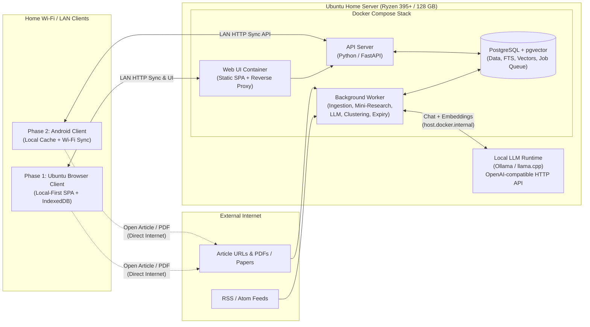

# System Architecture

> **Status:** In Review

## 1. High-Level Overview
SmartRSS uses a **containerized home-LAN backend** paired with **local-first clients** that cache curated items/metadata and queue offline mutations when detached from the home network.

A key design decision is decoupling the **Dockerized SmartRSS services** from the **host-native local LLM runtime** (`Ollama` or `llama.cpp`). On an AMD Ryzen AI Max+ 395 (128 GB unified memory) Ubuntu host, running the LLM server natively avoids brittle GPU passthrough inside containers while keeping the SmartRSS backend portable via Docker Compose.

## 2. Tech Stack & Rationale

| Layer | Choice | Rationale |
| :--- | :--- | :--- |
| **API Server** | Python 3.12+ / FastAPI | Fast development, strong typing (Pydantic v2), async HTTP, OpenAPI contract generation for both Web and Android clients. |
| **Background Worker** | Python async worker + PostgreSQL `SKIP LOCKED` queue | Reuses the exact same domain models/DB layer as API; eliminates Redis/Celery operational overhead while remaining durable and inspectable at ~200 items/day. |
| **Feed & Content Extraction** | `feedparser`, `httpx`, `trafilatura`, `pymupdf` (PyMuPDF) | Mature, battle-tested libraries for messy RSS/Atom XML, conditional HTTP, clean article extraction, and fast PDF text extraction for research papers. |
| **Database & Search** | PostgreSQL 16+ with `pgvector` and built-in `tsvector` FTS | Single containerized datastore handling concurrent API + worker writes, full-text search across articles + LLM metadata, vector similarity for story clustering, and durable job queues. |
| **Local LLM Client** | OpenAI-compatible HTTP API (`/v1/chat/completions`, `/v1/embeddings`) | Works transparently with both `Ollama` and `llama.cpp` server; easy to swap chat vs. embedding models independently. |
| **Phase 1 Client (Ubuntu)** | TypeScript SPA (React or Svelte) + IndexedDB (`Dexie.js` or `idb`) | Browser-native reading & one-click external link opening; full local-first cache and offline mutation outbox; served directly from the Docker stack. |
| **Phase 2 Client (Android)** | Thin Android app (Capacitor wrapping the Web UI, or native Kotlin) consuming the versioned Sync API | Works over plain home LAN HTTP without self-signed HTTPS/PWA certificate friction on Android, and enables native background sync on home Wi-Fi. |
| **Packaging** | Docker Compose (`web`, `api`, `worker`, `db`) | Clean, reproducible deployment in a diverse Ubuntu homelab environment. |

## 3. Components & Responsibilities

### 3.1 API Server (`api`)
- Exposes a versioned REST/JSON API (`/api/v1/...`).
- **Sync Endpoints**:
  - Downstream delta sync (`GET /api/v1/sync/pull?since_seq=...`) returning updated feeds, categories, items, enrichments, clusters, and settings using a monotonic server sequence number (`sync_seq`).
  - Upstream batch mutation sync (`POST /api/v1/sync/push`) accepting idempotent, client-timestamped actions (read/unread, star/unstar, feedback events, feed config updates).
- **Interactive / Management Endpoints**:
  - Feed CRUD, OPML import/export, feed health diagnostics.
  - Full-text & metadata search (server-side over full historical log).
  - Prompt template & user interest profile editor (with version history) and manual re-process / on-demand mini-research trigger.
  - System observability (worker queue status, LLM connectivity, recent errors).

### 3.2 Background Worker (`worker`)
Runs a lightweight scheduler + concurrent async job consumers backed by PostgreSQL:
1. **Feed Poller**: Schedules feed fetches using per-feed intervals, sends `If-None-Match` (`ETag`) and `If-Modified-Since`, respects HTTP 304/301/410, applies exponential backoff on errors, and updates feed health metrics.
2. **Content Extractor**: Normalizes entry metadata, canonicalizes URLs, fetches full HTML article text (`trafilatura`) when enabled, and falls back gracefully to the RSS summary on paywall/error.
3. **Mini-Research Fetcher**: Evaluates per-feed research policy, item heuristics (e.g., links to arXiv, PDFs, reports, or aggregator commentary links), and explicit user hints (`fetch_pdfs`). Fetches primary source(s) within strict guardrails (max depth, max MB, timeout) and extracts clean text (`trafilatura` or `pymupdf`).
4. **LLM Enrichment & Curation Stage**:
   - Generates embeddings for clustering/deduplication.
   - Calls local LLM with active system prompt, user interest profile, recent explicit feedback context, per-feed guidance, article text, and mini-research excerpts.
   - Enforces structured JSON schema output (`tldr`, `takeaways`, `tags`, `depth`, `relevance_score`, `relevance_rationale`, `research_context`).
5. **Deduplication & Story Clusterer**:
   - Exact/canonical URL match deduplication.
   - Cross-feed topic clustering via `pgvector` cosine similarity within a sliding time window (e.g., 72 hours), optionally confirmed by a fast LLM check for borderline matches.
6. **Expiration Sweeper**: Periodically marks unread, unstarred items older than their feed override (or global default) TTL as `expired` while preserving the full historical log.

### 3.3 Database (`db` — PostgreSQL + `pgvector`)
- System of record for all feeds, raw/normalized items, full historical log, LLM enrichments, research sources, clusters, explicit feedback, versioned prompt/profile configs, sync sequence log, and background jobs.
- Details documented in [docs/data-model.md](data-model.md).

### 3.4 Local-First Client (`web` + Phase 2 Android)
- Maintains a local database (IndexedDB on Web; SQLite/IndexedDB on Android) holding the active working set (all feeds/categories/settings + recent/unread/starred items & enrichments).
- **Automatic Reachability Detection**: Non-blocking health check determines `Connected (LAN)` vs. `Detached` state without interrupting reading.
- **Offline Mutation Outbox**: Every user action (read, star, feedback, unsubscribe/mute, feed config change) is applied optimistically to local storage and appended to a persistent outbox with a client-generated UUID and timestamp. When back on the home LAN, the outbox flushes idempotently to `/api/v1/sync/push`, followed by `/api/v1/sync/pull`.
- **External Link Handoff**: Clicking an article URL or primary-source PDF opens directly in the system browser using the client's internet connection.

## 4. Key Data Flows

### 4.1 Ingestion → Mini-Research → LLM Enrichment → Clustering
1. **Scheduler** enqueues `poll_feed` jobs when `next_fetch_at <= now()`.
2. **Feed Poller** fetches XML/JSON, creates new `items` rows (skipping known GUIDs/canonical URLs), updates feed health, and enqueues `extract_content` for each new item.
3. **Content Extractor** fetches full article HTML (if enabled), stores cleaned text, checks mini-research triggers (feed policy + link inspection), and enqueues `mini_research` (if triggered) or directly `enrich_item`.
4. **Mini-Research Fetcher** fetches primary linked PDF/HTML (respecting guardrails), stores `research_sources`, and enqueues `enrich_item`.
5. **LLM Enricher** computes item embedding, runs structured LLM completion against `Ollama`/`llama.cpp`, persists `item_enrichments` + `item_tags`, and enqueues `cluster_item`.
6. **Clusterer** queries recent items via `pgvector` similarity; either assigns the item to an existing `cluster` or creates a new single-item cluster, bumping `sync_seq` so clients pick up the enriched record on next sync.

### 4.2 Detached Reading & Reconnect Sync
1. While on home Wi-Fi, client calls `POST /api/v1/sync/push` (if outbox non-empty) then `GET /api/v1/sync/pull?since_seq=<cursor>` and updates local cache + cursor.
2. Client leaves home Wi-Fi → server probe fails → UI smoothly transitions to `Detached` badge; user reads cached items, opens links in browser, marks read/starred, gives feedback, or mutes/unsubscribes a feed.
3. All edits write to local cache + persistent outbox.
4. Client returns to home Wi-Fi → reachability check succeeds → client flushes outbox (server deduplicates via `client_mutation_id`, reconciles via per-field timestamps) and pulls latest server deltas.

### 4.3 Explicit Feedback & Prompt Evolution
1. User clicks thumbs up/down, adds a short reason, or triggers a feed hint (e.g., *"fetch PDFs here"*).
2. Client records a `feedback_event` (synced immediately or via outbox).
3. Feed-level hints (like *"fetch PDFs here"*) directly update the feed's `research_policy` and optionally enqueue a `mini_research` + re-enrichment job for recent items.
4. Item-level relevance feedback is stored in `feedback_events` and injected as compact recent positive/negative calibration examples into subsequent LLM curation prompts—while also being surfaced in the Curation Settings UI so the user can refine their editable Interest Profile and prompt templates.

## 5. External Integrations & Failure Modes

| Failure Mode | Mitigation |
| :--- | :--- |
| **Flaky / down RSS feed** | Timeouts, HTTP 304/301/410 handling, exponential backoff (`next_fetch_at`), error surfaced in Feed Health view without blocking other feeds. |
| **Full-text fetch blocked / paywalled (403/429)** | Log extraction status as `fallback_rss`, proceed with RSS summary/content so item is still enriched and readable. |
| **Mini-research bad link / huge PDF / redirect loop** | Strict guardrails: max 1 hop by default, max response size (e.g., 20 MB PDF / 5 MB HTML), max extracted chars fed to LLM, per-domain timeout & concurrency cap. |
| **Local LLM offline or saturated** | Items remain visible immediately in clients in `pending_enrichment` state; `enrich_item` jobs retry with backoff until Ollama/`llama.cpp` responds. |
| **Malformed LLM JSON output** | Use JSON schema / structured output mode supported by Ollama & `llama.cpp`, validate with Pydantic, retry once with repair prompt, then log error cleanly. |
| **Duplicate offline sync submissions** | Every client mutation carries a UUID (`client_mutation_id`); server checks `sync_mutations` table so retries are 100% idempotent. |

## 6. Deployment & Operations
- **Docker Compose Services**:
  - `db`: `pgvector/pgvector:pg16` with named persistent volume.
  - `api`: FastAPI container (uvicorn) connecting to `db`.
  - `worker`: Same Python image as `api` with worker entrypoint, connecting to `db` and host LLM endpoint via `extra_hosts: ["host.docker.internal:host-gateway"]`.
  - `web`: Nginx/Caddy serving the compiled SPA and reverse-proxying `/api/` to `api` on a single LAN port.
- **Configuration**: `.env` for infrastructure (DB credentials, LAN port, default LLM URL/models) + database-stored `app_settings` & `prompt_configs` for everything user-tunable via UI.
- **Backups**: Scheduled `pg_dump` script to host directory + OPML/config JSON export endpoint.
- **Observability**: Structured JSON logs (`stdout`), plus a built-in **System Health / Queue** UI tab showing pending/failed jobs, LLM latency/tokens, and feed fetch health.
