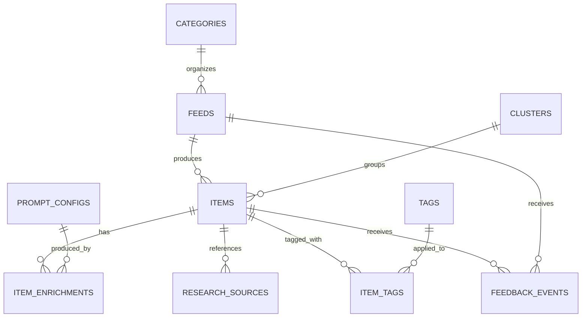

# Data Model

> **Status:** In Review

## 1. Core Entities
SmartRSS persists a complete historical log in PostgreSQL (`pgvector` enabled) while tracking lightweight client sync cursors via a monotonic sequence (`sync_seq`).

1. **Categories**: User-defined folders for organizing feeds.
2. **Feeds**: Subscribed RSS/Atom/JSON feeds, including HTTP polling state, health telemetry, expiration override, per-feed LLM guidance, and mini-research policy.
3. **Items**: Canonical ingested articles/entries, raw & extracted text, reading/star/expiration state, and cluster membership.
4. **Item Enrichments**: Local LLM outputs (TL;DR, takeaways, depth, relevance score + rationale, research context summary, vector embedding) linked to the exact prompt version and model used.
5. **Research Sources**: Primary referenced documents (PDFs, arXiv papers, linked reports/articles) fetched during mini-research for an item.
6. **Tags & Item Tags**: Topic/category tags generated by the LLM or added/edited by the user.
7. **Clusters**: Groups of items across feeds covering the same underlying story, paper, or announcement.
8. **Feedback Events**: Explicit user feedback on items, feeds, or clusters (votes, reasons, research directives).
9. **Prompt Configs & Interest Profile**: Versioned, user-editable LLM prompt templates and the active interest profile used for relevance scoring.
10. **Sync Mutations**: Idempotency log of client mutations applied from desktop/Android outboxes.
11. **Jobs**: PostgreSQL-backed durable async job queue for polling, extraction, mini-research, LLM enrichment, clustering, and expiration.
12. **App Settings**: Global defaults (default unread expiration days, LLM runtime config, mini-research safety guardrails).

## 2. Entity Relationships

## 3. Schema Details

### 3.1 `categories`
| Column | Type | Notes |
| :--- | :--- | :--- |
| `id` | `UUID` (PK) | |
| `name` | `TEXT` (UNIQUE, NOT NULL) | Folder/category display name |
| `sort_order` | `INT` (DEFAULT 0) | UI display ordering |
| `sync_seq` | `BIGINT` (NOT NULL, indexed) | Monotonic delta-sync watermark |
| `updated_at` | `TIMESTAMPTZ` | |
| `deleted_at` | `TIMESTAMPTZ` (NULL) | Soft delete for client sync tombstones |

### 3.2 `feeds`
| Column | Type | Notes |
| :--- | :--- | :--- |
| `id` | `UUID` (PK) | |
| `category_id` | `UUID` (FK → `categories.id`, NULL) | Optional folder |
| `feed_url` | `TEXT` (UNIQUE, NOT NULL) | RSS/Atom/JSON feed URL |
| `site_url` | `TEXT` | Website homepage |
| `title` | `TEXT` (NOT NULL) | Display title (editable) |
| `status` | `TEXT` (`active`, `paused`, `muted`, `unsubscribed`) | Supports offline mute/unsubscribe |
| `poll_interval_minutes` | `INT` (DEFAULT 60) | Base polling cadence |
| `etag` | `TEXT` | Conditional HTTP `ETag` |
| `last_modified` | `TEXT` | Conditional HTTP `Last-Modified` |
| `last_fetched_at` | `TIMESTAMPTZ` | Last fetch attempt |
| `last_success_at` | `TIMESTAMPTZ` | Last successful fetch |
| `next_fetch_at` | `TIMESTAMPTZ` (indexed) | Next scheduled poll (includes backoff) |
| `consecutive_errors` | `INT` (DEFAULT 0) | Feed health counter |
| `last_error` | `TEXT` | Last HTTP/parse error summary |
| `expiration_days_override` | `INT` (NULL) | `NULL` = global default; `0` = never expire |
| `fetch_full_text` | `BOOLEAN` (DEFAULT TRUE) | Whether server fetches full linked HTML |
| `research_policy` | `JSONB` | Per-feed mini-research config: `{enabled, fetch_pdfs, guidance, max_hops}` |
| `custom_prompt_hint` | `TEXT` | Per-feed curation/summarization instructions |
| `config_updated_at` | `TIMESTAMPTZ` | Used for offline config conflict resolution |
| `sync_seq` | `BIGINT` (NOT NULL, indexed) | |
| `created_at` / `updated_at` | `TIMESTAMPTZ` | |

### 3.3 `items`
| Column | Type | Notes |
| :--- | :--- | :--- |
| `id` | `UUID` (PK) | |
| `feed_id` | `UUID` (FK → `feeds.id`, NOT NULL) | |
| `cluster_id` | `UUID` (FK → `clusters.id`, NULL) | Assigned story cluster |
| `guid` | `TEXT` (NOT NULL) | Feed-provided GUID or fallback hash |
| `raw_url` | `TEXT` (NOT NULL) | Original link from feed |
| `canonical_url` | `TEXT` (indexed) | Normalized URL (tracking params stripped) |
| `title` | `TEXT` (NOT NULL) | |
| `author` | `TEXT` | |
| `published_at` | `TIMESTAMPTZ` (indexed) | Fallback to `fetched_at` if missing |
| `fetched_at` | `TIMESTAMPTZ` (NOT NULL) | |
| `raw_summary` | `TEXT` | Original RSS description/content |
| `extracted_text` | `TEXT` | Server-extracted full article text |
| `extraction_status` | `TEXT` (`pending`, `ok`, `fallback_rss`, `failed`) | |
| `content_hash` | `TEXT` | SHA-256 of normalized text for change/dup detection |
| `state` | `TEXT` (`unread`, `read`, `expired`) | Active inbox state |
| `is_starred` | `BOOLEAN` (DEFAULT FALSE) | Starred items never expire |
| `read_at` | `TIMESTAMPTZ` (NULL) | |
| `starred_at` | `TIMESTAMPTZ` (NULL) | |
| `expired_at` | `TIMESTAMPTZ` (NULL) | Set by expiration sweeper |
| `state_updated_at` | `TIMESTAMPTZ` | Last-write-wins timestamp for read/star sync |
| `search_vector` | `TSVECTOR` (GIN indexed) | Combined FTS over title, extracted_text, tldr, takeaways, tags |
| `sync_seq` | `BIGINT` (NOT NULL, indexed) | |

*Unique constraint*: `(feed_id, guid)`.

### 3.4 `item_enrichments`
Stores LLM output per item (keeping history when an item is re-processed with a newer prompt/model; `is_current = TRUE` marks the active enrichment).

| Column | Type | Notes |
| :--- | :--- | :--- |
| `id` | `UUID` (PK) | |
| `item_id` | `UUID` (FK → `items.id`, indexed) | |
| `is_current` | `BOOLEAN` (DEFAULT TRUE) | Unique partial index on `(item_id) WHERE is_current` |
| `status` | `TEXT` (`pending`, `completed`, `failed`) | |
| `prompt_config_id` | `UUID` (FK → `prompt_configs.id`) | Exact prompt version used |
| `model_name` | `TEXT` | e.g., `qwen3:32b` or `llama-3.3-70b` |
| `tldr` | `TEXT` | Concise summary |
| `takeaways` | `JSONB` | Array of strings (2–5 bullet takeaways) |
| `depth_type` | `TEXT` | `news-brief`, `deep-dive`, `paper-report`, `opinion`, `release-notes`, `discussion` |
| `relevance_score` | `SMALLINT` | 0–100 relevance score |
| `relevance_rationale` | `TEXT` | Short "why" explanation |
| `research_context` | `TEXT` (NULL) | Synthesized context from primary sources/PDFs |
| `embedding` | `VECTOR(768)` (HNSW indexed) | Configurable dimension matching chosen embedding model |
| `latency_ms` | `INT` | Observability metric |
| `prompt_tokens` / `completion_tokens` | `INT` | Observability metric |
| `error_message` | `TEXT` (NULL) | Failure diagnostics |
| `created_at` | `TIMESTAMPTZ` | |

### 3.5 `research_sources`
| Column | Type | Notes |
| :--- | :--- | :--- |
| `id` | `UUID` (PK) | |
| `item_id` | `UUID` (FK → `items.id`, indexed) | |
| `source_url` | `TEXT` (NOT NULL) | Primary paper/PDF/report URL |
| `source_type` | `TEXT` (`pdf`, `arxiv`, `html`, `repo`, `other`) | |
| `title` | `TEXT` | Extracted document title |
| `trigger_reason` | `TEXT` (`feed_policy`, `heuristic`, `user_feedback`, `manual`) | Why mini-research ran |
| `fetch_status` | `TEXT` (`pending`, `ok`, `skipped_guardrail`, `failed`) | |
| `extracted_excerpt` | `TEXT` | Truncated/cleaned text passed to LLM |
| `content_bytes` | `INT` | |
| `error_message` | `TEXT` | |
| `fetched_at` | `TIMESTAMPTZ` | |

### 3.6 `tags` & `item_tags`
- `tags`: `id (UUID)`, `slug (TEXT UNIQUE)`, `display_name (TEXT)`.
- `item_tags`: `(item_id, tag_id)` composite PK, `source` (`llm` | `user`), `created_at`.

### 3.7 `clusters`
| Column | Type | Notes |
| :--- | :--- | :--- |
| `id` | `UUID` (PK) | |
| `representative_item_id` | `UUID` (FK → `items.id`, NULL) | Highest-relevance or earliest primary item |
| `title` | `TEXT` | Cluster display title |
| `centroid_embedding` | `VECTOR(768)` | Running centroid for matching new items |
| `first_seen_at` / `last_seen_at` | `TIMESTAMPTZ` | Sliding cluster activity window |
| `item_count` | `INT` (DEFAULT 1) | Denormalized count for fast UI badges |
| `sync_seq` | `BIGINT` (NOT NULL, indexed) | |

### 3.8 `feedback_events`
| Column | Type | Notes |
| :--- | :--- | :--- |
| `id` | `UUID` (PK) | |
| `client_mutation_id` | `UUID` (UNIQUE, NULL) | Links to offline sync mutation |
| `target_type` | `TEXT` (`item`, `feed`, `cluster`) | |
| `target_id` | `UUID` (NOT NULL, indexed) | |
| `feedback_type` | `TEXT` | `thumbs_up`, `thumbs_down`, `more_like_this`, `less_like_this`, `fetch_pdfs`, `re_research`, `note` |
| `reason_text` | `TEXT` (NULL) | Optional user note/rationale |
| `payload` | `JSONB` | Extensible metadata (e.g., snapshot of score at feedback time) |
| `created_at` | `TIMESTAMPTZ` (indexed) | Client event timestamp |

### 3.9 `prompt_configs` & `interest_profiles`
- `prompt_configs`: `id`, `name` (`enrichment_system`, `enrichment_user`, `mini_research`, etc.), `version (INT)`, `template_text (TEXT)`, `model_override (TEXT NULL)`, `is_active (BOOLEAN)`, `notes (TEXT)`, `created_at`.
- `interest_profiles`: `id`, `version (INT)`, `profile_markdown (TEXT)` (editable plain-text description of user topics, priorities, depth preferences, and anti-preferences), `is_active (BOOLEAN)`, `sync_seq`, `created_at`.

### 3.10 `sync_mutations`, `jobs`, & `app_settings`
- `sync_mutations`: `client_mutation_id (UUID PK)`, `client_id (TEXT)`, `mutation_type (TEXT)`, `entity_type (TEXT)`, `entity_id (UUID)`, `client_timestamp (TIMESTAMPTZ)`, `server_applied_at (TIMESTAMPTZ)`, `outcome` (`applied`, `superseded`, `rejected`).
- `jobs`: `id (BIGSERIAL PK)`, `job_type (TEXT)`, `payload (JSONB)`, `priority (SMALLINT)`, `status` (`queued`, `running`, `done`, `failed`), `attempts (INT)`, `max_attempts (INT)`, `run_after (TIMESTAMPTZ)`, `locked_at (TIMESTAMPTZ)`, `last_error (TEXT)`, `created_at`.
- `app_settings`: `key (TEXT PK)`, `value (JSONB)`, `sync_seq (BIGINT)`, `updated_at`.

## 4. Deduplication & Normalization
1. **Per-Feed Entry Identity**: Deduplicate using `(feed_id, guid)` (falling back to normalized `raw_url` if a feed omits `<guid>`/`<id>`).
2. **URL Canonicalization**: Lowercase scheme/host, strip URL fragments (`#...`), remove known tracking parameters (`utm_*`, `ref`, `fbclid`, `gclid`, etc.), and strip trailing slashes where safe.
3. **Cross-Feed Exact Duplicates**: If a new item's `canonical_url` matches an existing item from another feed within the active lookback window (e.g., 14 days), link both into the same `cluster` immediately.
4. **Cross-Feed Topic / Story Clustering**:
   - Compute an embedding of `title + tldr + key_takeaways` (or `title + excerpt` pre-enrichment).
   - Query `clusters` active within the last 72 hours (configurable) via `pgvector` cosine distance.
   - If similarity exceeds the high threshold (e.g., `>= 0.86`), auto-merge into that cluster; if in the borderline band (e.g., `0.78–0.86`), optionally run a fast boolean local-LLM confirmation ("Are these two items covering the same underlying event/paper/release?").

## 5. Lifecycle, Sync Watermarks & Retention
- **Monotonic Sync Watermark (`sync_seq`)**: Backed by a single PostgreSQL sequence (`smartrss_sync_seq`). Any server-side insert or state/config update advances the row's `sync_seq = nextval('smartrss_sync_seq')`. Clients pull `WHERE sync_seq > :since_seq ORDER BY sync_seq ASC` in pages, eliminating clock-skew bugs.
- **Full Historical Log**: Items, enrichments, clusters, and feedback events are retained permanently for search, deduplication memory, and future model evolution (~73k items/year is well under 1–2 GB in PostgreSQL).
- **Unread Expiration**:
  - A periodic `expire_items` job updates items where `state = 'unread' AND is_starred = FALSE` and `published_at < now() - effective_ttl`, setting `state = 'expired'`, `expired_at = now()`, and bumping `sync_seq`.
  - `effective_ttl` resolves as: `feed.expiration_days_override` (if > 0) → never expire (if 0) → `app_settings.default_expiration_days` (e.g., 30 days).
  - Starred items are always immune to expiration; users can still view/search expired items in the History/Archive view.
- **Client Local Cache Window**: Clients cache all feeds, categories, active settings/profile, all `unread` + `starred` items, and a rolling window (e.g., last 14 days) of `read` items—keeping client storage small while full history remains searchable when connected to the LAN server.
