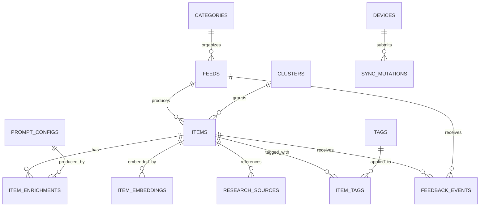
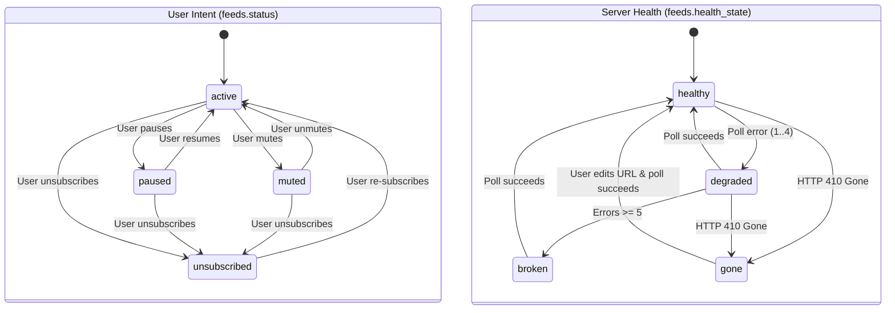

# Data Model

> **Status:** Approved *(2026-11-23, by project owner)*

## 1. Core Entities
SmartRSS persists a complete historical log in PostgreSQL 16+ (`pgvector` enabled) with a commit-ordered append-only sync change log and explicit per-field conflict metadata.

1. **`devices` & `pairing_codes`**: Per-device revocable bearer tokens (stored hashed) and short-lived one-time pairing codes.
2. **`sync_state` & `sync_changes`**: Single-row serialized sync watermark + `instance_epoch`, and an append-only log of synced entity upserts and tombstones.
3. **`categories`**: User-defined folders for organizing feeds.
4. **`feeds`**: Subscribed feeds with separated user intent (`status`) and server health (`health_state`), HTTP polling headers, backfill tracking, expiration overrides, per-feed LLM guidance, and mini-research policy.
5. **`items`**: Canonical ingested articles, raw & extracted text, per-field state timestamps (`read_state_updated_at`, `starred_updated_at`), cluster membership, and FTS `search_vector`.
6. **`item_enrichments`**: Versioned local LLM outputs (TL;DR, takeaways, depth, 5-tier calibrated relevance + rationale, research context) tied to exact prompt version and model.
7. **`item_embeddings`**: Model-versioned vector embeddings keyed by `(item_id, model_name)` so model/dimension upgrades never corrupt or block history.
8. **`research_sources`**: Primary referenced documents (PDFs, arXiv papers, reports) fetched during mini-research.
9. **`tags` & `item_tags`**: LLM-generated topic tags (Phase 1 is LLM-only; manual per-item tagging deferred).
10. **`clusters`**: Cross-feed story groups with representative item, activity window, and merge/split tracking.
11. **`feedback_events`**: Explicit user feedback on items (`thumbs_up`/`thumbs_down`), **per-feed written instructions/feedback** (`feed_instruction`), cluster splits, and feed config audit events.
12. **`prompt_configs` & `interest_profiles`**: Versioned, seeded-default + user-edited LLM prompt templates and editable Interest Profile.
13. **`sync_mutations`**: Idempotency log of applied/superseded/rejected client mutations.
14. **`jobs`, `pipeline_runs` & `stage_metrics`**: Operational PostgreSQL job queue (dedupe keys, leases/heartbeats, priorities, dead-letter state), batch/cron run summaries, and per-stage execution timing/token telemetry for pipeline fine-tuning.
15. **`app_settings`**: Global defaults (default expiration days, backfill cap, default poll interval, built-in cron windows / quiet hours, LLM runtime/model settings, per-model similarity thresholds, mini-research guardrails) plus internal operational timestamps (e.g., `last_retention_cleanup_at`). *(Worker process mode — continuous daemon vs. external cron — is deployment configuration (`WORKER_MODE` env var), not a DB setting.)*

## 2. Entity Relationships



## 3. State Machines

### 3.1 Item State Machine (`items.state` + independent `items.is_starred`)
- `is_starred` is orthogonal to `state`: starring an item never alters `state`, **except** starring an `expired` item leaves it visible in the Starred/Saved view and prevents future expiration.
- Un-starring an old `unread` item does **not** immediately expire it on the client; the next server `expire_items` sweep will transition it to `expired` if its age exceeds `effective_ttl`.
- Opening/viewing an `expired` item in the History/Archive view marks it `read` (if the user reads/opens it) or lets the user explicitly mark it `unread` (which resets its expiration grace clock via `unexpired_at` / `read_state_updated_at`).
- Items ingested from a `muted` feed (within backfill cap `N`) enter directly as `state = 'read'` with `read_at = fetched_at` and `read_state_updated_at = fetched_at` (still extracted for archive/search/dedup; LLM enrichment skipped by default in `1d` to conserve GPU time).
- Read state is tracked **per item**; exact duplicates and clustered stories render grouped in the UI, and **"Mark cluster read"** expands on the client into an explicit list of known `item_ids`.

```mermaid
stateDiagram-v2
    [*] --> unread : Ingested from active feed (within backfill cap N)
    [*] --> read : Ingested from muted feed (within backfill cap N; read_state_updated_at = fetched_at)
    [*] --> expired : Backfilled beyond cap N on subscribe/OPML (expired_at = read_state_updated_at = fetched_at)
    unread --> read : User marks read / opens / bulk mark-read
    read --> unread : User marks unread
    unread --> expired : Server expire_items sweep (not is_starred & age > effective_ttl)
    expired --> read : User opens or marks read in Archive
    expired --> unread : User explicitly marks unread (restores to inbox)
```



### 3.2 Feed Lifecycle: User Intent (`status`) vs. Server Health (`health_state`)
Separating user intent from server health ensures a broken feed never overwrites user mute/pause choices and vice versa.

- **User intent (`feeds.status`)**:
  - `active`: Polled normally; items appear in unread/relevance views.
  - `paused`: Polling suspended by user; existing items remain visible in views/history.
  - `muted`: Still polled, extracted, and archived into history (so deduplication/search stay complete), with new items auto-marked `read` at ingest time (`state = 'read'`, `read_at = fetched_at`, `read_state_updated_at = fetched_at`; LLM enrichment skipped by default in `1d`) until unmuted.
  - `unsubscribed`: Polling stopped; **existing unread non-starred items are hidden from active inbox views** (still retained in historical log and Starred view). Re-subscribing to the same `feed_url` reactivates the existing feed row (`status = 'active'`), clears conditional HTTP headers (`etag`, `last_modified`), deduplicates against existing items, and applies the standard backfill cap (`N`) only to newly fetched entries.
- **Server health (`feeds.health_state`)**:
  - `healthy`: Last poll succeeded (`consecutive_errors = 0`).
  - `degraded`: Transient errors (`1 <= consecutive_errors < 5`); exponential backoff applied.
  - `broken`: Persistent failure (`consecutive_errors >= 5`); polled at max backoff (e.g., 24h) and flagged in Feed Health UI.
  - `gone`: Server received HTTP `410 Gone`; polling suspended automatically until user intervenes.



### 3.3 Feed Polling & Edge-Case Policies
- **HTTP `301 Permanent Redirect`**: Update `feed_url` to the new canonical URL **unless** another row already owns that `feed_url`—in which case flag the feed as `health_state = 'broken'` with a clear duplicate-redirect diagnostic rather than crashing on the `UNIQUE` constraint.
- **HTTP `429 Too Many Requests` & `Cache-Control`**: Respect `Retry-After` headers and `Cache-Control: max-age` lower bounds, adding small random jitter (e.g., ±10%) to avoid thundering herds.
- **Per-Domain Article Fetch Politeness**: Enforce per-domain concurrency (`1`) and minimum delay (e.g., 1–2s) across `extract_content` and `mini_research` fetches.
- **Updated Entries (`entry_hash` change)**: If an already-ingested `(feed_id, guid)` returns a materially changed feed-entry `entry_hash` (SHA-256 of normalized feed `title + raw_summary`, never overwritten by extraction) while still `unread` (and within 7 days), update text, re-extract, and enqueue one re-enrichment; never flip a `read` or `expired` item back to `unread`.
- **Unstable GUIDs**: Match `(feed_id, guid)` first; if missing or mutated, fall back to matching `(feed_id, canonical_url)` within the feed before creating a new item — **only** when the fallback is unambiguous: exactly one existing item and exactly one incoming entry share that `canonical_url`, and the matched item's `guid` is absent from the current fetch (i.e., the GUID genuinely changed). Feeds whose entries share a link (comics, podcasts, "latest" pages) therefore never have new entries swallowed or older items overwritten.

## 4. Schema Details

### 4.1 `devices` & `pairing_codes`
- `devices`: `id (UUID PK)`, `name (TEXT)`, `platform (TEXT: ubuntu|android|web)`, `token_hash (TEXT UNIQUE NOT NULL)`, `created_at`, `last_seen_at`, `revoked_at (TIMESTAMPTZ NULL)`.
- `pairing_codes`: `id (UUID PK)`, `code_hash (TEXT UNIQUE NOT NULL)`, `device_name (TEXT)`, `expires_at (TIMESTAMPTZ NOT NULL)`, `consumed_at (TIMESTAMPTZ NULL)`, `created_by_device_id (UUID NULL)`.

### 4.2 `sync_state` & `sync_changes`
- `sync_state`: Single row (`id SMALLINT PK CHECK (id = 1)`), `current_seq BIGINT NOT NULL DEFAULT 0`, `pruned_through_seq BIGINT NOT NULL DEFAULT 0` (`CHECK >= 0`; exact contiguous retention boundary for `cursor_pruned`), `instance_epoch UUID NOT NULL`, `updated_at TIMESTAMPTZ`.
- `sync_changes`:
  - `seq BIGINT PK` (allocated under `SELECT ... FROM sync_state WHERE id = 1 FOR UPDATE` at transaction end—see [ADR 0004](decisions/0004-sync-watermark-aggregates-and-restore-epoch.md))
  - `entity_type TEXT NOT NULL` (`category`, `feed`, `item`, `cluster`, `interest_profile`, `app_settings`)
  - `entity_id UUID NOT NULL`
  - `op TEXT NOT NULL` (`upsert`, `delete`)
  - `changed_at TIMESTAMPTZ NOT NULL DEFAULT now()`
  - **Singleton entity sentinel UUIDs**: Because `app_settings` uses a `SMALLINT = 1` PK and `interest_profile` syncs as a single logical active document, `sync_changes.entity_id` uses fixed deterministic UUID constants for singleton entity types:
    - `app_settings`: `00000000-0000-0000-0000-000000000001` (`APP_SETTINGS_ENTITY_ID`)
    - `interest_profile`: `00000000-0000-0000-0000-000000000002` (`INTEREST_PROFILE_ENTITY_ID`)
  - Index on `(entity_type, entity_id)` for optional compaction/lookup; retention pruned after 90 days.

### 4.3 `categories`
| Column | Type | Notes |
| :--- | :--- | :--- |
| `id` | `UUID` (PK) | |
| `name` | `TEXT` (NOT NULL) | Unique partial index `WHERE deleted_at IS NULL` |
| `sort_order` | `INT` (DEFAULT 0) | |
| `updated_at` | `TIMESTAMPTZ` | |
| `deleted_at` | `TIMESTAMPTZ` (NULL) | Emits `delete` tombstone in `sync_changes` |

### 4.4 `feeds`
| Column | Type | Notes |
| :--- | :--- | :--- |
| `id` | `UUID` (PK) | |
| `category_id` | `UUID` (FK → `categories.id`, NULL) | |
| `feed_url` | `TEXT` (UNIQUE, NOT NULL) | |
| `site_url` | `TEXT` | |
| `title` | `TEXT` (NOT NULL) | |
| `status` | `TEXT` (`active`, `paused`, `muted`, `unsubscribed`) | User intent |
| `health_state` | `TEXT` (`healthy`, `degraded`, `broken`, `gone`) | Server polling health |
| `poll_interval_minutes` | `INT` (DEFAULT 60) | |
| `etag` / `last_modified` | `TEXT` | Conditional HTTP headers |
| `last_fetched_at` / `last_success_at` / `next_fetch_at` | `TIMESTAMPTZ` | `next_fetch_at` indexed |
| `consecutive_errors` | `INT` (DEFAULT 0) | |
| `last_error` | `TEXT` | |
| `initial_backfill_done` | `BOOLEAN` (DEFAULT FALSE) | Drives `N`-item backfill cap on first poll |
| `expiration_days_override` | `INT` (NULL) | `NULL` = global default; `0` = never expire |
| `fetch_full_text` | `BOOLEAN` (DEFAULT TRUE) | |
| `research_policy` | `JSONB` | `{enabled, fetch_pdfs, guidance, max_hops}` |
| `curation_instructions` | `TEXT` | Standing per-feed natural-language LLM directives (e.g., *"look for topic X"*, *"skip weekly roundups"*); online-only optimistic-versioned edit (`config_version`) |
| `field_updated_at` | `JSONB` (NOT NULL DEFAULT `'{}'`) | Per-field LWW timestamps (`status`, `category_id`, `title`, `expiration_days_override`, `poll_interval_minutes`, granular `research_policy.enabled` and `research_policy.fetch_pdfs`, etc.) |
| `config_version` | `INT` (DEFAULT 1) | Optimistic concurrency token; increments **only** on `curation_instructions` writes (independent of `field_updated_at` LWW fields) |
| `created_at` / `updated_at` | `TIMESTAMPTZ` | |

### 4.5 `items`
| Column | Type | Notes |
| :--- | :--- | :--- |
| `id` | `UUID` (PK) | |
| `feed_id` | `UUID` (FK → `feeds.id`, NOT NULL) | |
| `cluster_id` | `UUID` (FK → `clusters.id`, NULL) | Assigned story cluster |
| `guid` | `TEXT` (NOT NULL) | Unique constraint `(feed_id, guid)` |
| `raw_url` | `TEXT` (NOT NULL) | |
| `canonical_url` | `TEXT` (indexed) | Normalized URL: lowercase scheme/host, default ports (`80`/`443`) removed, fragments stripped, trailing non-root slash removed, query params sorted, and tracking params stripped (prefixes `utm_`, `mtm_`, `pk_`; explicit names including `fbclid`, `gclid`, `dclid`, `gbraid`, `wbraid`, `mc_cid`, `mc_eid`, `ref`, `ref_src`, `ref_url`, `source`, `igshid`, `si`, `spm`, `yclid`, `_hsenc`, `_hsmi`, `mkt_tok`, `oly_anon_id`, `oly_enc_id`, `vero_id`, `s_cid`, and AT Internet / Piano Analytics `at_medium`, `at_campaign`, `at_campaign_type`, `at_custom1`–`at_custom4`, `at_format`, `at_link`, `at_link_id`, `at_link_type`, `at_link_origin`, `at_ptr_name`, `at_bbc_team`, `at_creation`, `at_variant` — explicit names only, never bare `at_`) |
| `title` | `TEXT` (NOT NULL) | |
| `author` | `TEXT` | |
| `published_at` | `TIMESTAMPTZ` | Display timestamp, clamped to `<= fetched_at` |
| `fetched_at` | `TIMESTAMPTZ` (NOT NULL, indexed) | Authoritative clock for unread expiration |
| `raw_summary` | `TEXT` | Untrusted RSS HTML (sanitized on client) |
| `extracted_text` | `TEXT` | Server-extracted plain text |
| `extraction_status` | `TEXT` (`pending`, `ok`, `fallback_rss`, `failed`) | |
| `entry_hash` | `TEXT` | SHA-256 of normalized feed-entry `title + "\n" + raw_summary`; owned by `poll_feed` for update detection (never overwritten by extraction) |
| `content_hash` | `TEXT` | SHA-256 of normalized `title + "\n" + (extracted_text or raw_summary)`; updated by `extract_content` on `ok` and used for `1e` content dedup |
| `state` | `TEXT` (`unread`, `read`, `expired`) | |
| `is_starred` | `BOOLEAN` (DEFAULT FALSE) | Orthogonal to `state`; never expires |
| `read_at` / `starred_at` / `expired_at` | `TIMESTAMPTZ` (NULL) | |
| `read_state_updated_at` | `TIMESTAMPTZ` (NOT NULL) | Independent LWW timestamp for `state` (initialized to `fetched_at` on insert) |
| `starred_updated_at` | `TIMESTAMPTZ` (NOT NULL) | Independent LWW timestamp for `is_starred` (initialized to `fetched_at` on insert) |
| `unexpired_at` | `TIMESTAMPTZ` (NULL) | Set if user restores an `expired` item to `unread` |
| `ingest_sync_seq` | `BIGINT` (NOT NULL DEFAULT 0) | Commit-ordered `sync_changes.seq` allocated at initial ingest (`poll_feed`); indexed for pruning-proof bounded `mark_bulk_read` |
| `search_vector` | `TSVECTOR` (GIN indexed) | Rebuilt in application code on item/enrichment/tag update; configurable language (`english`); `extracted_text` sliced to first 64 KB (well under Postgres 1 MB limit) |

### 4.6 `item_enrichments`
| Column | Type | Notes |
| :--- | :--- | :--- |
| `id` | `UUID` (PK) | |
| `item_id` | `UUID` (FK → `items.id`, indexed) | |
| `is_current` | `BOOLEAN` (DEFAULT TRUE) | Unique partial index `(item_id) WHERE is_current` |
| `status` | `TEXT` (`pending`, `completed`, `inherited`, `failed`) | `inherited` = exact-URL duplicate referencing cluster primary |
| `prompt_config_id` | `UUID` (FK → `prompt_configs.id`) | Exact prompt version |
| `model_name` | `TEXT` | e.g., `qwen3:30b-a3b` |
| `tldr` | `TEXT` | Concise summary |
| `takeaways` | `JSONB` | Array of 2–5 bullet strings |
| `depth_type` | `TEXT` | `news-brief`, `deep-dive`, `paper-report`, `opinion`, `release-notes`, `discussion` |
| `relevance_tier` | `SMALLINT` (`CHECK (relevance_tier BETWEEN 1 AND 5)`) | `1=Skip`, `2=Low`, `3=Worth a Look`, `4=High`, `5=Must Read` |
| `relevance_rationale` | `TEXT` | Concise "why" explanation |
| `research_context` | `TEXT` (NULL) | Synthesized primary-source context |
| `feed_instructions_hash` | `TEXT` (NULL) | SHA-256 of effective `curation_instructions` + active `feed_instruction` notes used during enrichment (for UI transparency & offline eval) |
| `prompt_eval_ms` / `generation_ms` | `INT` (NULL) | Runtime-reported prompt evaluation & token generation durations (when provided by Ollama/`llama.cpp`) |
| `latency_ms` / `prompt_tokens` / `completion_tokens` | `INT` | Total LLM call wall-clock latency and token counts |
| `parse_retries` | `SMALLINT` (DEFAULT 0) | Number of JSON schema recovery retries required |
| `error_message` | `TEXT` (NULL) | |
| `created_at` | `TIMESTAMPTZ` | |

### 4.7 `item_embeddings` (Model-Versioned)
Separates vector storage from `item_enrichments` so changing the embedding model or dimension never breaks existing rows or mixes vector spaces:
- `item_id (UUID FK → items.id)`, `model_name (TEXT)`, `dimensions (INT)`, `input_kind (TEXT DEFAULT 'title_excerpt')`, `embedding (VECTOR)` (stored L2-normalized), `created_at (TIMESTAMPTZ)`.
- Composite PK: `(item_id, model_name)`.
- Canonical embedding input: **`title + first 1,500 chars of extracted_text (or raw_summary)`** (single consistent vector space computed pre-enrichment).
- Model-specific HNSW partial index created for the active `(model_name, dimensions)` over recent/active items; similarity queries filter strictly to `model_name = :active_model` and items/clusters within the active clustering time window (e.g., 72h).
- Similarity thresholds (e.g., `auto_merge_threshold`, `borderline_threshold`) are stored per embedding model in `app_settings`. Switching embedding models uses a documented re-embed/re-cluster backfill job (candidate project skill).

### 4.8 `research_sources`, `tags`, `item_tags`, `clusters`, `feedback_events`
- **`research_sources`**: `id`, `item_id`, `source_url`, `source_type` (`pdf`, `arxiv`, `html`, `repo`, `other`), `title`, `trigger_reason` (`feed_policy`, `heuristic`, `user_request`), `fetch_status` (`pending`, `ok`, `skipped_guardrail`, `failed`), `extracted_excerpt`, `page_count`, `content_bytes`, `error_message`, `fetched_at`.
- **`tags` & `item_tags`**: `tags(id, slug UNIQUE, display_name)`, `item_tags(item_id, tag_id, created_at)` — **LLM-generated only in Phase 1** (re-enrichment replaces an item's tags transactionally and emits an `item` upsert in `sync_changes`).
- **`clusters`**: `id`, `representative_item_id`, `title`, `max_relevance_tier (SMALLINT)`, `first_seen_at`, `last_seen_at`, `item_count`, `deleted_at (TIMESTAMPTZ NULL)`.
  - **Representative & display tier**: Representative is the highest `relevance_tier` item (tie-broken by earliest `fetched_at`, preferring items with full-text/research context). Cluster list row displays `max_relevance_tier` and `item_count`.
  - **Merge/Split rules**: Merging cluster B into A reassigns B's items to A (emitting `item` upserts) and soft-deletes B (emitting `cluster` `delete` tombstone). User **"Split from cluster"** moves the chosen item into its own new single-item cluster, records a `cluster_exclusions(item_id, excluded_cluster_id)` row so it won't be re-merged, and emits `item` + `cluster` events in `sync_changes`.
- **`feedback_events`**: `id`, `client_mutation_id (UUID UNIQUE NULL)`, `target_type` (`item`, `feed`, `cluster`), `target_id`, `feedback_type` (`thumbs_up`, `thumbs_down`, `feed_instruction`, `split_cluster`, `config_fetch_pdfs_audit`, `note`), `reason_text`, `payload (JSONB)` (includes snapshot of `relevance_tier`, `prompt_config_id`, `model_name`, `feed_instructions_hash` at feedback time for offline evaluation), `archived_at (TIMESTAMPTZ NULL)`, `created_at`.
  - **Per-feed written instructions (`target_type = 'feed'`, `feedback_type = 'feed_instruction'`)**: Append-only natural-language directives (e.g., *"look for topic X"*, *"ignore job posts"*) that can be captured inline even while offline. All active (`archived_at IS NULL`) `feed_instruction` rows for a feed are injected into the LLM prompt alongside `feeds.curation_instructions`. Users can archive/retire a note (setting `archived_at`) or promote/consolidate notes into `feeds.curation_instructions` without deleting historical audit records; adding or archiving a `feed_instruction` emits a parent `feed` `upsert` in `sync_changes`.
  - Note: Clicking *"Fetch PDFs for this feed"* executes a single authoritative `feed_config_update` mutation (`research_policy.fetch_pdfs = true`) that **atomically** logs a `config_fetch_pdfs_audit` feedback event—never two competing writes.

### 4.9 `prompt_configs`, `interest_profiles`, `sync_mutations`, `jobs`, `pipeline_runs`, `stage_metrics`, `app_settings`
- **`prompt_configs`**: `id`, `name` (`enrichment_system`, `enrichment_user`, `mini_research`, etc.), `version (INT)`, `origin` (`default` | `user`), `default_revision (TEXT NULL)`, `template_text`, `model_override`, `is_active`, `notes`, `created_at`.
  - **Seeding & Upgrades**: Shipped prompt templates live in repo files and are seeded on startup with `origin = 'default'`. User edits create a new active row with `origin = 'user'`; future app upgrades add new `origin = 'default'` revisions without overwriting an active `origin = 'user'` prompt (surfacing an optional "View updated default" diff in the UI).
- **`interest_profiles`**: `id`, `version (INT)`, `profile_markdown`, `is_active`, `created_at`. Online-only edit with optimistic `version` check.
- **`sync_mutations`**: `client_mutation_id (UUID PK)`, `device_id (UUID FK → devices.id)`, `mutation_type`, `entity_type`, `entity_id (UUID NULL)`, `payload_sha256 (TEXT NOT NULL)`, `client_timestamp`, `effective_timestamp`, `server_applied_at`, `outcome` (`applied`, `superseded`, `rejected`), `rejection_reason (TEXT NULL)`, `affected_count (INT NULL)`. Pruned after 90 days.
- **`jobs`**:
  - `id (BIGSERIAL PK)`, `job_type`, `dedupe_key (TEXT NOT NULL)`, `payload (JSONB)`, `feed_id (UUID NULL)`, `item_id (UUID NULL)`, `run_id (UUID NULL FK → pipeline_runs.id ON DELETE SET NULL)`, `priority (SMALLINT DEFAULT 50)`, `status` (`queued`, `running`, `done`, `failed`), `attempts (INT DEFAULT 0)`, `max_attempts (INT DEFAULT 5)`, `run_after (TIMESTAMPTZ DEFAULT now())`, `locked_by (TEXT NULL)`, `locked_at (TIMESTAMPTZ NULL)`, `started_at (TIMESTAMPTZ NULL)`, `lease_expires_at (TIMESTAMPTZ NULL)`, `heartbeat_at (TIMESTAMPTZ NULL)`, `finished_at (TIMESTAMPTZ NULL)`, `queue_wait_ms (INT NULL)`, `duration_ms (INT NULL)`, `last_error (TEXT NULL)`, `created_at`, `updated_at`.
  - **Dedupe index**: `CREATE UNIQUE INDEX uq_jobs_active_dedupe ON jobs (job_type, dedupe_key) WHERE status IN ('queued', 'running')`.
  - **Reclaim & Retention**: Reaper resets `running` jobs where `lease_expires_at < now()` back to `queued` (or `failed` dead-letter if `attempts >= max_attempts`); dead-lettered jobs can be retried/dismissed in System Health UI; `done` jobs pruned after 30 days.
  - **Stage Idempotency**: Every stage (`poll_feed`, `extract_content`, `cluster_item`, `mini_research`, `enrich_item`, `expire_items`) uses upserts/natural keys so re-execution after a crash never duplicates records.
- **`pipeline_runs`**:
  - `id (UUID PK)`, `trigger (TEXT)` (`scheduler_window` | `cron_cli` | `manual`), `stages (TEXT[])`, `status (TEXT)` (`running` | `completed` | `partial` | `failed`), `started_at (TIMESTAMPTZ NOT NULL)`, `finished_at (TIMESTAMPTZ NULL)`, `duration_ms (INT NULL)`, `feeds_polled (INT NOT NULL DEFAULT 0)` (feeds successfully polled, including HTTP `304`), `feeds_not_modified (INT NOT NULL DEFAULT 0)` (subset of `feeds_polled` answered with HTTP `304 Not Modified`), `items_polled (INT DEFAULT 0)` (new items ingested by `poll_feed`; exposed in `worker run-once --json` alongside `items_ingested`), `items_extracted (INT DEFAULT 0)`, `items_clustered (INT DEFAULT 0)`, `items_researched (INT DEFAULT 0)`, `items_enriched (INT DEFAULT 0)`, `jobs_failed (INT DEFAULT 0)`, `total_llm_ms (BIGINT DEFAULT 0)`, `notes (TEXT NULL)`.
  - Tracks scheduled cron windows and `worker run-once` batch executions so users can inspect end-to-end batch duration and tune schedules. Pruned after 180 days.
- **`stage_metrics`**:
  - `id (BIGSERIAL PK)`, `run_id (UUID NULL FK → pipeline_runs.id ON DELETE SET NULL)`, `job_type (TEXT NOT NULL)`, `feed_id (UUID NULL)`, `item_id (UUID NULL)`, `model_name (TEXT NULL)`, `prompt_config_id (UUID NULL)`, `status (TEXT NOT NULL)` (`ok` | `failed` | `skipped`; `304 Not Modified` stays `'ok'` so success-rate rollups count conditional hits as healthy), `outcome (TEXT NULL CHECK (outcome IN ('fetched', 'not_modified')))` (set by `poll_feed` on successful HTTP 2xx / 304 responses; `NULL` for errors, skips, and other job types), `http_status (SMALLINT NULL)` (final HTTP status code recorded by `poll_feed` when a response was received; `NULL` otherwise), `queue_wait_ms (INT NOT NULL)`, `duration_ms (INT NOT NULL)`, `llm_prompt_ms (INT NULL)`, `llm_gen_ms (INT NULL)`, `prompt_tokens (INT NULL)`, `completion_tokens (INT NULL)`, `readiness_lag_ms (BIGINT NULL)` (recorded on `enrich_item`: `enriched_at - items.fetched_at`), `created_at (TIMESTAMPTZ NOT NULL DEFAULT now())`.
  - Indexed on `(job_type, created_at)` and `(feed_id, created_at)`. Enables fast exact SQL `p50`/`p95`/`avg` latency, tok/s, readiness lag, and per-feed GPU cost queries even after `jobs` rows are pruned at 30 days. Pruned after 180 days (~15–20 MB total at ~200 items/day).
- **`app_settings`** (single row, `id SMALLINT PK CHECK (id = 1)`):
  - `1a` columns: `default_expiration_days (INT NOT NULL DEFAULT 30)`, `backfill_cap (INT NOT NULL DEFAULT 10)`, `default_poll_interval_minutes (INT NOT NULL DEFAULT 60)`, `last_retention_cleanup_at (TIMESTAMPTZ NULL)`, `updated_at`.
  - Env vars (`DEFAULT_*`) seed the row only in the initial migration; the DB is authoritative thereafter (changed via `smartrss settings set` in `1a`, and via the sync/settings API from `1b`/`1c`).
  - `last_retention_cleanup_at` is an **internal operational** column: it is never client-synced and writing it does not emit an `app_settings` sync change. LLM/clustering/research columns are added in `1d`–`1f`.

## 5. Sync Surface, Conflict Resolution & Bulk Semantics

### 5.1 Sync Surface Table (Downstream)
| Entity (`sync_changes.entity_type`) | Synced Representation | Change Signal (`upsert`) | Removal Signal (`delete`) |
| :--- | :--- | :--- | :--- |
| `category` | Category row (`id`, `name`, `sort_order`) | Insert/update emits `category` `upsert` | Soft-delete (`deleted_at`) emits `category` `delete` |
| `feed` | Feed row + `status`, `health_state`, `poll_interval_minutes`, `expiration_days_override`, `research_policy`, `curation_instructions`, **embedded `active_feed_instructions[]`** (active non-archived `feed_instruction` notes), `config_version`, `field_updated_at` *(omits online-only `last_fetched_at`/`last_success_at`)* | Poll health change, config edit, or feed instruction add/archive emits `feed` `upsert` | Never hard-deleted (unsubscribe emits `feed` `upsert` with `status='unsubscribed'`) |
| `cluster` | Cluster row (`id`, `representative_item_id`, `title`, `max_relevance_tier`, `item_count`, `last_seen_at`) | Cluster creation/member/title/tier update emits `cluster` `upsert` | Emptied or merged cluster emits `cluster` `delete` |
| `item` *(Aggregate)* | Item core fields + `state`, `is_starred`, `cluster_id` + **embedded** current `item_enrichment`, LLM `tags[]`, `research_sources[]` summaries (url/title/type/status), and current user item vote (`thumbs_up`/`thumbs_down`/reason) | Item ingest, state/star change, extraction, enrichment, tag replacement, research update, cluster reassignment, or item feedback emits parent `item` `upsert` | Items are permanent history (evicted locally by client window, never deleted on server) |
| `interest_profile` | Active `interest_profiles` row (`version`, `profile_markdown`) | New active version emits `interest_profile` `upsert` | N/A (always one active profile) |
| `app_settings` | Public client-relevant settings (`default_expiration_days`, `backfill_cap`, etc.) | Update emits `app_settings` `upsert` | N/A |

*(Internal tables `jobs`, `pipeline_runs`, `stage_metrics`, `sync_mutations`, `item_embeddings`, `devices`, `pairing_codes`, and `prompt_configs` are **not** pushed down via `sync_changes`; `prompt_configs` and pipeline metrics are accessed online-only via dedicated management endpoints.)*

### 5.2 Per-Field Conflict Resolution & Merge Table (Upstream `sync/push`)
- **Clock-Skew Clamping & Dead-RTC Lower Bound**: For every client mutation, the server rejects timestamps older than `server_now - 90 days` (`reason = "clock_skew"`) and clamps future timestamps to `effective_ts = LEAST(client_timestamp, server_now + INTERVAL '5 minutes')`. Every `bootstrap`, `pull`, and `push` response includes `server_now` so clients can surface clock-drift warnings (`|client_now - server_now| > 5m`) without penalizing multi-day offline travel.
- **Push Response Contract**: `POST /api/v1/sync/push` returns `{instance_epoch, server_now, results: [{client_mutation_id, outcome: "applied" | "superseded" | "rejected", reason?, affected_count?, current_entity_type?, current_entity?}]}` (deliberately omitting `watermark`) so the client removes applied/superseded items from the outbox and rolls back + notifies the user on `rejected`.

| Mutable Field / Action | Offline Allowed? | Conflict Policy & Authority | Interaction with `expired` |
| :--- | :--- | :--- | :--- |
| `items.state` (`read` / `unread`) | Yes | Per-field LWW comparing `effective_ts` against `items.read_state_updated_at`. | Server expiration writes `read_state_updated_at = expired_at`. A later client `read` or `unread` wins; an *older* offline `unread` made before expiration is `superseded` (or if client explicitly restores from Archive, timestamp is newer and wins). |
| `items.is_starred` | Yes | Per-field LWW comparing `effective_ts` against `items.starred_updated_at` (independent of `state`). | Starring an `expired` item succeeds and preserves it in Starred view (`state` unchanged unless also opened/restored). |
| `mark_cluster_read` | Yes | Expands on client to explicit `item_ids[]` known at action time; applies per-item `state='read'` LWW. | Items added to the cluster *after* the offline action remain `unread`. |
| `mark_bulk_read` (feed/category/all/older-than-X) | Yes | Two-tier semantics: explicit `scope='items'` (`item_ids[]`) applies true per-item LWW over `state IN ('unread', 'read')` (epoch-agnostic); scoped modes (`all`/`feed`/`category`) are bounded by `{scope, up_to_sync_seq, epoch, older_than_ts?}`, reject stale `epoch != instance_epoch` (`epoch_mismatch`), and filter `state = 'unread'` + `ingest_sync_seq <= up_to_sync_seq` (owner-accepted non-commuting carve-out `RR-1`). | Never marks unseen items (including post-restore items); `expired` items are excluded in all modes (`RR-2`). |
| `feeds.status`, `category_id`, `expiration_days_override`, `research_policy.fetch_pdfs`, `research_policy.enabled` | Yes | Per-field LWW via `feeds.field_updated_at[field_name]`. | N/A |
| Item feedback (`thumbs_up` / `thumbs_down` / `reason`) | Yes | Append-only in `feedback_events` (deduped by `client_mutation_id`); latest event per item defines displayed vote state. | Allowed on expired items. |
| Feed written instruction (`feed_instruction` add / archive) | Yes | Append-only creation in `feedback_events` (deduped by `client_mutation_id`); archiving sets `archived_at` idempotently by `feedback_event_id`. Emits parent `feed` `upsert`. | N/A |
| `split_cluster` | Yes | Idempotent per `(item_id, source_cluster_id)`; ignored (`superseded`) if item already left that cluster. | Allowed. |
| Feed add / OPML import / standing `feeds.curation_instructions` / `interest_profiles` / `prompt_configs` | **No (Online-only)** | Optimistic version check (`expected_version`); returns `409 Conflict` with server version so full free-text block edits are never silently overwritten. | N/A |

## 6. Expiration, Backfill, Bootstrap & Storage Lifecycle

### 6.1 Exact Unread Expiration Formula (`expire_items`)
Expiration is measured strictly from **`items.fetched_at`** (or `items.unexpired_at` if the user manually restored an expired item to `unread`), preventing missing, backfilled, or future-dated RSS `<pubDate>` values from misbehaving:
```text
effective_ttl_days(item, feed, settings):
  if item.is_starred:
    return NEVER
  if feed.expiration_days_override == 0:
    return NEVER
  if feed.expiration_days_override is not NULL:
    ttl = feed.expiration_days_override
  else:
    ttl = settings.default_expiration_days  # default 30

  age_anchor = COALESCE(item.unexpired_at, item.fetched_at)
  expire if item.state == 'unread' AND age_anchor < (now() - ttl days)
```

### 6.2 Client Bootstrap, Server-Base Overlay, Cache Window & Eviction
- **Bootstrap**: `GET /api/v1/sync/bootstrap` returns feeds, categories, active `interest_profile`, client `app_settings`, active clusters, and items matching `state = 'unread' OR is_starred = TRUE OR (state = 'read' AND read_at >= now() - INTERVAL '14 days')`, plus `{watermark, instance_epoch}`. Clients stream bootstrap pages into a resumable staging area and keep server-confirmed base records (`items_base`/`feeds_base`) separate from displayed records (`display = base ⊕ fold(outbox)`), so pull updates and rejected-mutation rollbacks never restore stale local snapshots.
- **48-Hour Acknowledged Replay Journal**: Clients retain server-acknowledged replayable mutations (`item_set_state`, `item_set_starred`, `feed_set_field`, `scope='items'` bulk mark-read, plus chunked `scope='items'` rewrites of applied scoped bulk reads with `<= 5,000` captured IDs) for a rolling 48-hour window and promote them into the outbox on both `epoch_mismatch` and `cursor_ahead` restore recovery.
- **Local Eviction**: After each pull, the client evicts local items (from both base and display tables) where `is_starred == false` and `(state == 'expired' OR (state == 'read' AND read_at < now() - 14 days))` unless referenced by any pending outbox mutation. Incoming deltas for already-evicted out-of-window items are ignored unless the delta transitions `state` to `unread` or `is_starred` to `true`.

### 6.3 Realistic Storage & Retention Estimates (~200 items/day ≈ 73k items/year)
- `items` (including `extracted_text` avg ~20–30 KB + `raw_summary`): ~2.0–2.5 GB/year (compressed TOAST in Postgres typically brings this down ~2–3× to ~1.0–1.5 GB/year).
- `research_sources` excerpts (~15% of items): ~0.3–0.5 GB/year.
- `item_enrichments` + `item_embeddings` (768–1024 dim vectors + HNSW index) + `search_vector` GIN index: ~1.5–3.0 GB/year.
- **Total estimated DB footprint**: **~3–6 GB/year** (comfortably negligible on a 128 GB Ryzen host).
- **Operational Retention Cleanup**:
  - `jobs` (`status = 'done'`): pruned after **30 days**.
  - `sync_mutations` & `sync_changes`: pruned after **90 days** (clients detached > 90 days receive `resync_required` and seamlessly run `bootstrap`).
  - `stage_metrics` & `pipeline_runs`: pruned after **180 days** (~15–20 MB total footprint; retains 6 months of per-stage/per-feed/per-model timing history for schedule and model tuning).
  - Historical domain tables (`items`, `item_enrichments`, `research_sources`, `clusters`, `feedback_events`): retained permanently.
