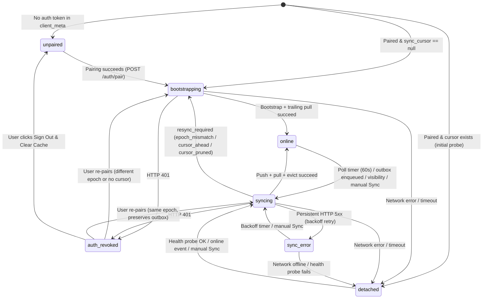

# Component Design 1c: Local-First Ubuntu Reader UI, Detached Offline Shell & System Health

> **Status:** **In Design Review** *(Drafted 2026-11-25 on branch `milestone/1c`; key trade-offs `1c-D01`–`1c-D04` confirmed by project owner)*
> **Milestone:** `1c` — Local-First Ubuntu Reader UI & Detached Mode ([Requirements §6](../requirements.md#6-milestones--phasing))
> **Requirements Covered:** `FR-FEED-01` (UI for feeds, categories, OPML), `FR-FEED-03` (Feed Health UI), `FR-STATE-01`–`02` (item state views, Starred/Archive, restore expired), `FR-STATE-03` (bounded bulk mark-read UI; cluster grouping scaffolded for `1e`), `FR-STATE-04` (connected archive FTS + detached local search), `FR-SYNC-01`–`04` (bootstrap, pull, outbox, 48h replay journal, restore recovery, rejection rollback UX, offline/online gating), `FR-UI-01`–`02` (classic 3-pane reader, sortable headers, filters, keyboard shortcuts), `NFR-SEC-01` (device pairing & revocation UI), `NFR-SEC-03` (DOMPurify, remote image blocking, strict CSP, XSS-safe snippets), `NFR-SYNC-01`–`02` (gap-free cursor rules, 500-mutation flush, `navigator.storage.persist()`, Service Worker offline reload), `NFR-OPS-01` (System Health & Pipeline Metrics UI)
> **Related ADRs:** [ADR 0002](../decisions/0002-native-sync-api-and-detached-client-model.md), [ADR 0004](../decisions/0004-sync-watermark-aggregates-and-restore-epoch.md), [ADR 0005](../decisions/0005-phase1-client-origin-and-offline-shell.md), [ADR 0006](../decisions/0006-lan-security-ssrf-and-content-isolation.md)
> **Prerequisite Specs:** [`1a-backend-ingestion-and-security.md`](1a-backend-ingestion-and-security.md), [`1b-sync-protocol-and-search.md`](1b-sync-protocol-and-search.md)

---

## 1. Scope & Boundaries

Milestone `1c` delivers the Phase 1 Ubuntu laptop local-first reader SPA, its fixed `localhost` offline-capable static runner and Service Worker shell, the Dexie.js IndexedDB cache and persistent mutation outbox, detached local search, DOMPurify + strict CSP untrusted-content rendering, device pairing/management, feed/OPML management, and the System Health & Pipeline Performance Metrics UI — consuming the `1a` and `1b` REST/sync APIs with **zero database migrations or breaking backend API changes**.

### In Scope for `1c`
1. **Frontend Application (`frontend/`)**:
   - React 19 + TypeScript (`strict: true`) + Vite 6 + Tailwind CSS v4 (static build-time CSS; zero runtime inline styles) + Dexie.js + DOMPurify + MiniSearch, built reproducibly from `package-lock.json` (`npm ci`).
   - **Device Pairing & Auth Lifecycle**: Initial pairing screen (`POST /api/v1/auth/pair`), paired devices list, one-time pairing code generator (`POST /api/v1/auth/pairing-codes`), device revocation (`POST /api/v1/devices/{id}/revoke`), and graceful `401` auth-revoked recovery without destroying pending offline mutations.
   - **Dexie.js Local Store & Storage Persistence**: IndexedDB schema mirroring `1b`'s forward-compatible sync envelope, `navigator.storage.persist()` startup request + denial warning banner, and local 14-day read/expired eviction respecting active outbox references.
   - **Client Sync Engine & Persistent Outbox**: Multi-tab `navigator.locks` + `BroadcastChannel` coordination, multi-page `bootstrap` pinned to Page 1 `watermark`, FIFO chunked `push` (`<= 500` mutations / `<= 5,000` explicit `item_ids` / `<= 1.5 MiB` body), poison-pill bisection on `422`/`413`, 48-hour acknowledged replay journal, `epoch_mismatch` restore recovery (rewriting pending scoped bulk-read mutations to `scope='items'`), deterministic optimistic-overlay reconciliation, rejection rollback + toast/banner UX, and `server_now` clock-drift detection (`> 5 min`).
   - **Service Worker Offline Shell**: Small, auditable Vite-built `sw.ts` with build-time hashed precache manifest, cache-first `/assets/*`, offline navigation fallback to `/index.html`, and strict network-only bypass for `/api/*`, cross-origin LAN API calls, and `/client-config.json`.
   - **Connected & Detached Search**: Connected full-archive FTS via `GET /api/v1/search` (display-only per `1b` `P-17`, never bulk-merged into Dexie) and detached local search via `MiniSearch` hydrated incrementally from Dexie, sharing one XSS-safe `SnippetFragment[][]` renderer.
   - **Classic 3-Pane Reader UX**: Left category/feed sidebar with unread & health badges, sortable middle item list/table (`Relevance`, `Date`, `Feed`, `Depth`) with filters and bounded bulk mark-read, right Reading Pane with DOMPurify-sanitized `raw_summary` (remote images blocked by default), safe external browser handoff, offline feed controls, forward-compatible `1d`–`1g` metadata slots, and full keyboard navigation.
   - **Management & Observability Views**: Online-only Feed/Category CRUD + OPML import/export, optimistic-versioned `curation_instructions` editor (`409` conflict diff UX), Global `app_settings` editor, Feed Health table with manual "Poll Now", System Health overview + job queue counts + `24h`/`7d`/`30d` stage latency & per-feed cost metrics + recent `pipeline_runs` history, and Dead-Letter Queue retry/dismiss controls.
2. **Localhost Runner & Ubuntu Desktop Packaging (`client-runner/`, `deploy/`)**:
   - Zero-dependency Python 3.12 stdlib static HTTP server (`client-runner/smartrss_client_runner.py`) bound to `127.0.0.1:4173`, canonicalizing `127.0.0.1` → `http://localhost:4173`, enforcing strict `Host` allow-list, path-traversal protection, and strict CSP with `connect-src` pinned to the configured LAN API origin.
   - User `systemd` service (`deploy/systemd/smartrss-client.service`), env template (`smartrss-client.env.example`), and XDG desktop launcher (`deploy/desktop/smartrss.desktop`).
3. **Docker `web` Fallback & Tooling Integration**:
   - Multi-stage `frontend/Dockerfile` (`node:22-alpine` → `nginx:1.27-alpine`) wired into `docker-compose.yml` `web` service with updated `deploy/nginx/nginx.conf` + `deploy/nginx/security-headers.conf` serving the compiled SPA as the connected-only LAN fallback (ADR 0005).
   - Default `CORS_ALLOW_ORIGINS` updated in `.env.example`, `docker-compose.yml`, and `backend/src/smartrss/config.py` from `http://localhost:8080` to `http://localhost:8080,http://localhost:4173`.
   - `Makefile` targets (`frontend-lint`, `frontend-typecheck`, `frontend-test-cov`, `runner-test`, `frontend-e2e`) and `scripts/check-frontend-coverage.mjs` (`>= 80%` core coverage gate) integrated into `make check`.

### Explicitly Out of Scope for `1c`
- Backend DB schema migrations or new API endpoints (all needed endpoints already exist from `1a` and `1b`).
- Local LLM enrichment, Prompt Config / Interest Profile editors, and LLM phase telemetry (`prompt_eval_ms`/`generation_ms`) (`1d` — `1c` renders clean forward-compatible slots whenever `item.enrichment` is populated).
- Story clustering UI actions (`split_cluster`, `mark_cluster_read`) and cluster generation (`1e` — `clusters` table and `item.cluster_id` are stored forward-compatibly in Dexie).
- Mini-research extraction and "Dig Deeper" trigger (`1f` — `research_policy.enabled` and `research_policy.fetch_pdfs` offline toggles are wired in `1c`; `research_sources[]` renders if present).
- Explicit item feedback (`thumbs_up`/`thumbs_down`), inline `feed_instruction` notes, and offline eval harness (`1g`).
- Phase 2 Android Capacitor/Kotlin packaging (UI layout stays responsive and Capacitor-compatible, without Android build artifacts).

---

## 2. Key `1c` Design Trade-offs & Decisions

Decisions `1c-D01`–`1c-D04` were explicitly confirmed by the project owner on 2026-11-25 (resolving [Requirements §7](../requirements.md#7-open-questions) Open Question #1).

| # | Decision Area | Chosen Approach | Alternative(s) Considered | Rationale |
| :--- | :--- | :--- | :--- | :--- |
| **1c-D01** *(Req §7 #1)* | **Phase 1 `localhost` client packaging** *(Owner-confirmed)* | **Zero-dependency Python 3.12 stdlib static HTTP server (`client-runner/smartrss_client_runner.py`) on fixed `http://localhost:4173` + systemd user unit + `.desktop` launcher** (with Docker `web` Nginx serving the same bundle as connected-only LAN fallback). | Tauri v2 desktop wrapper (Rust + WebKitGTK2). | Zero native Rust/WebKitGTK build friction on Ubuntu laptops, identical browser/Playwright E2E environment, instant Chromium/Firefox PWA "Install as App" support, and guaranteed `localhost` secure context for SW + `navigator.storage.persist()` (ADR 0005). |
| **1c-D02** | **Remote images inside untrusted feed HTML (`raw_summary`)** *(Owner-confirmed)* | **Block remote images by default**: strict CSP `img-src 'self'`, pre-sanitization detached transform replacing `` with an inert alt-text / external-link placeholder, and DOMPurify forbidding `` tags in sanitized output. | Allow remote HTTPS images (`img-src 'self' data: https:`) with `referrerpolicy="no-referrer"`. | Eliminates tracking pixels and third-party network beacons while reading, prevents broken-image noise when detached, matches `nginx.conf`'s strict stance, and produces zero CSP console violations. |
| **1c-D03** | **Frontend styling, tooling & strict CSP compatibility** *(Owner-confirmed)* | **React 19 + TypeScript (`strict: true`) + Vite 6 + Tailwind CSS v4 (static build-time CSS) + `npm` (`package-lock.json` + `npm ci`)**. Strictly **zero inline `<script>` or `style="..."` attributes** anywhere in HTML, JSX, or sanitized feed output. | Plain CSS Modules; runtime CSS-in-JS (`styled-components`/Emotion). | Tailwind v4 compiles to a single static hashed CSS file fully compatible with strict `style-src 'self'` (no `'unsafe-inline'`), supports dense classic 3-pane RSS layouts + dark/light CSS variables, and keeps bundle size tiny and Capacitor-friendly. |
| **1c-D04** | **Detached local search engine** *(Owner-confirmed)* | **`MiniSearch` in-memory weighted inverted index** hydrated incrementally from Dexie, paired with a pure `websearch`-compatible query parser (`"phrases"`, `-negation`, negation-only rejection) and structured XSS-safe `SnippetFragment[][]` extractor. | Dexie `multiEntry` token table; zero-dependency custom scan. | Sub-5 ms weighted BM25 search across 2,000–10,000 working-set items without bloating IndexedDB storage, and emits the exact `SnippetFragment[][]` shape returned by `GET /api/v1/search` so connected and detached search share one safe React renderer. |
| **1c-D05** | **CSP `connect-src` pinning for cross-origin LAN API** | Local runner requires/defaults `SMARTRSS_API_ORIGIN` (strictly validated `http(s)://host[:port]`, default `http://localhost:8080`), emits `connect-src 'self' <api_origin>`, and serves `GET /client-config.json` (`Cache-Control: no-store`). Docker `web` emits `connect-src 'self'` with `api_origin: ""`. | Broad `connect-src 'self' http: https:` wildcard; local API reverse proxy in the runner. | Keeps CSP strictly pinned to one exact LAN API origin (preventing arbitrary exfiltration), avoids a second reverse proxy on the laptop, preserves IndexedDB if the server LAN IP changes later, and prevents CSP header injection via strict origin parsing. |
| **1c-D06** | **Service Worker implementation** | **Small, auditable custom `sw.ts`** (~120 LOC) with a tiny Vite build plugin injecting the exact hashed precache manifest. Precaches only static app-shell files; strictly bypasses `/api/*`, cross-origin API requests, and `/client-config.json`. | Workbox / `vite-plugin-pwa` default runtime caching. | Zero opaque runtime caching magic, zero risk of accidentally caching sensitive authenticated API responses or stale `/client-config.json`, easy security audit, and deterministic Playwright offline-reload verification. |
| **1c-D07** | **Multi-tab sync safety & optimistic-UI consistency** | Serialize all sync cycles via **`navigator.locks.request('smartrss-sync-cycle')`** + `BroadcastChannel('smartrss-sync')` notifications. Re-apply pending `outbox` overlay inside the same Dexie `rw` transaction whenever `bootstrap` or `pull` writes rows. | Uncoordinated per-tab timers; naive `db.items.put()` during pull. | Prevents duplicate concurrent flushes or interleaved cursor writes across tabs, and eliminates UI flicker where an in-flight `pull` temporarily reverts an unpushed offline read/star toggle before `push` completes. |
| **1c-D08** | **Credential storage, `401` handling & poison-pill outbox protection** | Store `{device_id, device_name, platform, bearer_token, api_origin}` in Dexie `client_meta` (protected by `navigator.storage.persist()`). On `401`, pause sync (`auth_revoked`) while **preserving outbox & cache** for re-pairing. On batch `422`/`413`, bisect to isolate and quarantine any single malformed mutation into `failed_mutations` with rollback. | Store token in `localStorage` and wipe DB on `401`; infinite retry on `422`. | Atomic state lifecycle with IndexedDB, zero silent loss of offline work if a device token is accidentally revoked, and immunity to outbox head-of-line blocking (`L1`). |

---

## 3. Repository Layout, Tooling & Build Pipeline

### 3.1 Directory & Module Structure

```text
smartrss/
├── client-runner/
│   ├── smartrss_client_runner.py          # Zero-dep Python 3.12 stdlib localhost static server (127.0.0.1:4173)
│   └── tests/
│       └── test_client_runner.py          # pytest suite: Host check, 308 localhost redirect, CSP injection, path traversal, headers
├── deploy/
│   ├── nginx/
│   │   ├── nginx.conf                     # Updated: static Vite SPA + /api/ proxy + Cache-Control + /client-config.json
│   │   ├── security-headers.conf          # Included in every location block (prevents Nginx add_header inheritance drop)
│   │   └── client-config.json             # Static `{"mode":"lan_fallback","api_origin":""}`
│   ├── systemd/
│   │   ├── smartrss-client.service        # User systemd unit launching smartrss_client_runner.py
│   │   └── smartrss-client.env.example    # SMARTRSS_API_ORIGIN, SMARTRSS_CLIENT_PORT, SMARTRSS_DIST_DIR
│   └── desktop/
│       └── smartrss.desktop               # XDG desktop launcher opening http://localhost:4173
├── frontend/
│   ├── Dockerfile                         # Multi-stage: node:22-alpine (npm ci + build) -> nginx:1.27-alpine
│   ├── package.json
│   ├── package-lock.json                  # Committed lockfile for reproducible builds (T5)
│   ├── tsconfig.json                      # strict: true, noUncheckedIndexedAccess: true, exactOptionalPropertyTypes: true
│   ├── vite.config.ts                     # React + Tailwind v4 + custom SW manifest emitter + SW bundle entry
│   ├── vitest.config.ts                   # Vitest + jsdom + fake-indexeddb + v8 coverage JSON report
│   ├── playwright.config.ts               # Chromium E2E against live FastAPI/PG test stack + smartrss_client_runner.py
│   ├── eslint.config.js                   # ESLint flat config (TS strict, React hooks, forbid inline `style` prop & dangerouslySetInnerHTML outside SafeHtml)
│   ├── index.html                         # Zero inline script/style; loads /src/main.tsx & /manifest.webmanifest
│   ├── public/
│   │   ├── manifest.webmanifest
│   │   └── icons/
│   │       ├── icon-192.png
│   │       ├── icon-512.png
│   │       └── icon.svg
│   └── src/
│       ├── main.tsx
│       ├── App.tsx
│       ├── styles/app.css                 # Tailwind v4 `@import "tailwindcss";` + light/dark CSS tokens + prose rules
│       ├── types/
│       │   ├── api.ts                     # Exact TS mirrors of 1a/1b REST & system schemas
│       │   ├── sync.ts                    # Exact TS mirrors of SyncBootstrap/Pull/Push DTOs & mutation union
│       │   └── ui.ts                      # View filters, sort keys, connection/sync state enums
│       ├── security/
│       │   ├── urlSafety.ts               # isSafeHttpUrl(), safeExternalHref(), safeOrigin() (S4)
│       │   └── sanitizeHtml.ts            # Detached DOMParser img->placeholder + DOMPurify strict allow-list (NFR-SEC-03)
│       ├── db/
│       │   ├── schema.ts                  # Dexie v1 schema & typed tables
│       │   └── clientMeta.ts              # Atomic meta/auth/cursor helpers + persistence request
│       ├── api/
│       │   └── client.ts                  # Typed fetch client (Bearer auth, strict CORS-safe headers, timeouts, typed errors)
│       ├── sync/
│       │   ├── probe.ts                   # /api/v1/health reachability probe & timeout handling
│       │   ├── reconciliation.ts          # Pure deterministic overlay, pull apply, eviction, epoch_mismatch rewrite, clock drift
│       │   ├── outbox.ts                  # Optimistic local mutations, FIFO chunking, bisect poison-pill, 48h replay journal, rollback
│       │   └── engine.ts                  # Web Locks coordinator, BroadcastChannel, bootstrap/push/pull loop
│       ├── search/
│       │   ├── queryParser.ts             # Pure websearch-compatible parser ("phrase", -negation, negation-only error)
│       │   └── localSearch.ts             # MiniSearch weighted index + structured XSS-safe SnippetFragment[][] generator
│       ├── sw/
│       │   ├── sw.ts                      # Minimal auditable Service Worker
│       │   └── register.ts                # Registration & update notification (skips gracefully on insecure origins)
│       ├── hooks/
│       │   ├── useSyncEngine.ts
│       │   ├── useReaderItems.ts
│       │   ├── useSearch.ts
│       │   ├── useKeyboardShortcuts.ts
│       │   └── useStoragePersistence.ts
│       ├── components/
│       │   ├── layout/                    # TopBar, AlertStrip, AppShell
│       │   ├── auth/                      # PairingScreen, AuthRevokedBanner
│       │   ├── reader/                    # Sidebar, ItemList, ItemRow, ReadingPane, SafeHtml, SnippetText, BulkReadMenu, SmartMetadataCard
│       │   ├── feeds/                     # FeedManagerView, AddFeedModal, EditFeedModal, ConflictDiffDialog, CategoryManager, OpmlPanel
│       │   ├── health/                    # SystemHealthView, StageMetricsTable, FeedCostTable, PipelineRunsTable, FeedHealthTable, DeadLetterTable
│       │   ├── settings/                  # SettingsDevicesView, AppSettingsForm, DevicesPanel, OutboxInspector
│       │   └── common/                    # StatusPill, ConfirmDialog, ToastStack, ShortcutsModal
│       └── test/
│           ├── unit/                      # Vitest + fake-indexeddb unit/integration specs
│           ├── fixtures/                  # Hostile XSS HTML fixtures, recorded sync/search/metrics payloads
│           └── e2e/                       # Playwright E2E specs
└── scripts/
    └── check-frontend-coverage.mjs        # Enforces >= 80% line/branch coverage on frontend core modules
```

### 3.2 Environment, CORS & Build Tooling
- **Development Prerequisites**: Node.js 22 LTS (`node`, `npm`) + Playwright Chromium (`npx playwright install chromium`) on the Ubuntu development host for running `make frontend-check` / `make frontend-e2e`; production Docker builds (`web`) compile inside `node:22-alpine` with `npm ci` (`T5`) and copy only `frontend/dist/` into `nginx:1.27-alpine`.
- **Backend CORS Default Update (Minor `1c` Infra Touchpoint)**:
  - Update default `CORS_ALLOW_ORIGINS` in `backend/src/smartrss/config.py`, `.env.example`, and `docker-compose.yml` from `http://localhost:8080` to `http://localhost:8080,http://localhost:4173` (retaining strict no-wildcard validation).
  - Document in `README.md` / `.env.example` that LAN deployments should add their server LAN hostname/IP to `ALLOWED_HOSTS` (e.g., `smartrss.lan:8080,192.168.1.50:8080`) and any LAN fallback origin to `CORS_ALLOW_ORIGINS` (e.g., `http://smartrss.lan:8080,http://localhost:4173`).
- **CORS-Safe Request Header Invariant**:
  - Backend `CORSMiddleware` (`backend/src/smartrss/api/app.py`) explicitly allows `allow_methods=["GET", "POST", "PUT", "PATCH", "DELETE", "OPTIONS"]`, `allow_headers=["Authorization", "Content-Type"]`, `allow_credentials=False`.
  - Therefore `frontend/src/api/client.ts` MUST:
    - Always set `credentials: "omit"` and `cache: "no-store"` (fetch option, not a custom request header).
    - Send ONLY CORS-allow-listed headers: `Authorization: Bearer <token>` (for authenticated routes), `Accept: application/json` (or `application/xml` for OPML export), and `Content-Type: application/json` on mutation requests (`POST`/`PATCH`/`PUT`/`DELETE`). Never send custom headers (`X-Requested-With`, `Cache-Control`, etc.) that would fail CORS preflight.
- **`Makefile` Targets**:
  - `make frontend-lint`: `npm --prefix frontend run lint` (ESLint + Prettier check)
  - `make frontend-typecheck`: `npm --prefix frontend run typecheck` (`tsc --noEmit`)
  - `make frontend-test-cov`: `npm --prefix frontend run test:cov && node scripts/check-frontend-coverage.mjs frontend/coverage/coverage-summary.json`
  - `make runner-test`: `uv run --directory backend pytest ../client-runner/tests --cov=../client-runner/smartrss_client_runner --cov-fail-under=90`
  - `make frontend-e2e`: Starts `db-test`, launches a real ephemeral FastAPI instance + `smartrss_client_runner.py` serving `frontend/dist`, and runs `npm --prefix frontend run test:e2e` (Playwright Chromium).
  - `make check`: Runs backend (`lint`, `typecheck`, `test-cov`), `runner-test`, and frontend (`frontend-lint`, `frontend-typecheck`, `frontend-test-cov`). (`make test-e2e` runs `frontend-e2e` and is also part of milestone verification.)

---

## 4. Localhost Client Runner, Nginx Fallback & Strict CSP

### 4.1 `client-runner/smartrss_client_runner.py`
A single-file, zero-dependency Python 3.12 stdlib `ThreadingHTTPServer` serving the compiled static SPA bundle on the user's Ubuntu laptop:

| Behavior | Specification |
| :--- | :--- |
| **Bind Address & Port** | Strictly binds `127.0.0.1` on `SMARTRSS_CLIENT_PORT` (default `4173`, configurable `1024..65535`). Never binds `0.0.0.0`. |
| **Strict `Host` Validation** | Accepts ONLY `localhost:<port>`, `127.0.0.1:<port>`, or `[::1]:<port>` (case-insensitive). Any other `Host` header returns `400 Bad Request` (`text/plain`), blocking DNS rebinding against the local runner itself. |
| **Origin Canonicalization (`308`)** | Any request whose `Host` is `127.0.0.1:<port>` or `[::1]:<port>` receives `308 Permanent Redirect` to `http://localhost:<port><raw_path_and_query>` (stripping leading `//` to prevent open redirect). Guarantees the user always lands on ONE browser origin (`http://localhost:4173`) so IndexedDB and the Service Worker are never split across `127.0.0.1` vs `localhost`. |
| **`SMARTRSS_API_ORIGIN` Validation** | Parsed at startup via `urllib.parse.urlsplit`: MUST be `http` or `https`, non-empty `hostname`, no `username`/`password`, `path` in `("", "/")`, empty `query` and `fragment`, and zero ASCII control chars / whitespace / `;` / `,` (prevents CSP header injection). Normalized to `scheme://host[:port]` (default `http://localhost:8080`). Startup aborts non-zero on invalid value. |
| **`GET /client-config.json`** | Dynamically returns `{"mode":"localhost","api_origin":"<validated_origin>"}` with `Content-Type: application/json; charset=utf-8` and `Cache-Control: no-store`. |
| **Path Traversal & Symlink Guard (`S1`/`S5`)** | Rejects null bytes, backslashes, or non-GET/HEAD methods (`405`). Resolves candidate file with `Path.resolve()` and asserts `candidate.is_relative_to(dist_root)` (`dist_root = Path(dist_dir).resolve()`). Directory listing is completely disabled. |
| **Extension-Aware SPA Fallback** | If the resolved path is an existing regular file under `dist_root`, serve it with explicit safe MIME types (`.html`, `.js`, `.css`, `.json`, `.webmanifest`, `.svg`, `.png`, `.woff2`, `.ico`). If missing: return `404 Not Found` if the last path segment contains a file extension (e.g., `/assets/missing.js` never returns HTML as JS!), else serve `dist_root/index.html` (`200 OK`) for SPA routes. |
| **Cache-Control Matrix** | `/client-config.json` → `no-store`; `/index.html`, `/sw.js`, `/manifest.webmanifest` (and SPA fallback routes) → `no-cache`; `/assets/*` (Vite content-hashed) → `public, max-age=31536000, immutable`. |
| **Graceful Shutdown (`L2`)** | Handles `SIGTERM` and `SIGINT` cleanly by closing the listening socket and exiting `0`. |

### 4.2 Exact Security Headers & Content Security Policy

Both `smartrss_client_runner.py` and Docker `web` (`deploy/nginx/security-headers.conf`) emit the following headers on **every** response:

```http
X-Content-Type-Options: nosniff
Referrer-Policy: no-referrer
X-Frame-Options: DENY
Permissions-Policy: camera=(), microphone=(), geolocation=(), payment=()
```

- **Localhost Runner CSP (`http://localhost:4173`)**:
  ```http
  Content-Security-Policy: default-src 'self'; script-src 'self'; style-src 'self'; img-src 'self'; font-src 'self'; connect-src 'self' <SMARTRSS_API_ORIGIN>; manifest-src 'self'; worker-src 'self'; object-src 'none'; base-uri 'none'; form-action 'none'; frame-ancestors 'none';
  ```
- **Docker `web` Fallback CSP (`deploy/nginx/security-headers.conf`)**:
  ```http
  Content-Security-Policy: default-src 'self'; script-src 'self'; style-src 'self'; img-src 'self'; font-src 'self'; connect-src 'self'; manifest-src 'self'; worker-src 'self'; object-src 'none'; base-uri 'none'; form-action 'none'; frame-ancestors 'none';
  ```
- **Nginx `add_header` Inheritance Guard**: In Nginx, adding `add_header Cache-Control ...` inside a `location` block silently drops all `server`-level `add_header` directives. Therefore `deploy/nginx/nginx.conf` places all security headers in `deploy/nginx/security-headers.conf` and explicitly `include /etc/nginx/snippets/security-headers.conf;` inside **every** `location` block (`/`, `/assets/`, `= /sw.js`, `= /index.html`, `= /client-config.json`, `/api/`).
- **Zero-Inline-Style & Zero-Inline-Script Enforcement**:
  - `frontend/index.html` contains zero `<script>` inline blocks and zero `style=` attributes.
  - ESLint forbids React `style={...}` props across `frontend/src/` (and forbids `dangerouslySetInnerHTML` everywhere except `SafeHtml.tsx`, which exclusively consumes `sanitizeFeedHtml()` output).
  - Playwright E2E registers a `document.addEventListener("securitypolicyviolation", ...)` collector and **fails the test** if even a single CSP violation fires during any user flow or hostile XSS render!

### 4.3 Ubuntu Laptop Installation (`deploy/systemd/` & `deploy/desktop/`)
- `deploy/systemd/smartrss-client.service`: User-level `systemd` unit (`~/.config/systemd/user/smartrss-client.service`) reading `~/.config/smartrss-client/config.env` (`SMARTRSS_API_ORIGIN`, `SMARTRSS_CLIENT_PORT=4173`, `SMARTRSS_DIST_DIR=%h/.local/share/smartrss/dist`), running `python3 %h/.local/share/smartrss/smartrss_client_runner.py`, with `Restart=on-failure`.
- `deploy/desktop/smartrss.desktop`: Standard XDG launcher (`Exec=xdg-open http://localhost:4173`) so SmartRSS launches from the Ubuntu desktop launcher (and can also be installed as a standalone window via Chromium's "Install SmartRSS" PWA button).

---

## 5. Local Data Model (Dexie.js IndexedDB Schema & Storage Persistence)

### 5.1 Dexie v1 Schema (`frontend/src/db/schema.ts`)

Database name: `smartrss_v1`. All UUIDs stored as lowercase strings; all timestamps stored as canonical UTC ISO-8601 strings (`YYYY-MM-DDTHH:mm:ss.sssZ`, lexicographically sortable in IndexedDB!).

| Table | Primary Key | Indexes | Stored Shape & Purpose |
| :--- | :--- | :--- | :--- |
| **`client_meta`** | `key` | *(none)* | Singleton rows keyed by string: `'auth'` (`{device_id, device_name, platform, bearer_token, api_origin, paired_at}`), `'sync'` (`{instance_epoch, sync_cursor, last_sync_at, last_server_now, clock_drift_ms}`), `'app_settings'` (`SyncAppSettingsDTO`), `'interest_profile'` (`{version, profile_markdown} \| null`), `'ui_prefs'` (`{theme, default_sort, density, auto_mark_read_on_select}`). |
| **`categories`** | `id` | `sort_order, name` | Mirrors `SyncCategoryDTO` (`id, name, sort_order, updated_at`). Soft-deleted categories are removed locally on `delete` tombstone. |
| **`feeds`** | `id` | `category_id, status, health_state, title` | Mirrors `SyncFeedDTO` (`id, category_id, feed_url, site_url, title, status, health_state, poll_interval_minutes, consecutive_errors, last_error, expiration_days_override, fetch_full_text, research_policy, curation_instructions, active_feed_instructions, config_version, field_updated_at, updated_at`). |
| **`clusters`** | `id` | `max_relevance_tier, last_seen_at` | Forward-compatible `1e` table (`id, representative_item_id, title, max_relevance_tier, item_count, last_seen_at`). Empty in `1c`. |
| **`items`** | `id` | `feed_id, cluster_id, state, is_starred, fetched_at, published_at, read_at, ingest_sync_seq, [state+fetched_at], [feed_id+state], [is_starred+fetched_at]` | Mirrors `SyncItemDTO` (`id, feed_id, cluster_id, raw_url, canonical_url, title, author, published_at, fetched_at, raw_summary, summary_truncated, lead_excerpt, extraction_status, state, is_starred, read_at, starred_at, expired_at, unexpired_at, read_state_updated_at, starred_updated_at, ingest_sync_seq, enrichment, tags, research_sources, user_feedback, updated_at`) plus derived `effective_date = published_at ?? fetched_at` indexed for fast date sorting. |
| **`outbox`** | `++local_seq` | `&client_mutation_id, entity_key, status` | Persistent FIFO queue of unsynced mutations: `{local_seq, client_mutation_id, created_at, status: 'pending' \| 'in_flight', payload: SyncMutationInput, entity_key: 'item:<id>' \| 'feed:<id>' \| 'bulk', previous_snapshot: PreviousSnapshot \| null, captured_item_ids: string[] \| null, captured_item_snapshots: Record<string, ItemStateSnapshot> \| null, attempts: number, last_error: string \| null}`. |
| **`replay_journal`** | `client_mutation_id` | `acknowledged_at` | Rolling **48-hour** log of server-acknowledged epoch-agnostic mutations (`item_set_state`, `item_set_starred`, `feed_set_field`, `item_mark_bulk_read` with `scope='items'`): `{client_mutation_id, acknowledged_at, payload}`. Pruned on every sync cycle where `acknowledged_at < now - 48h`. |
| **`failed_mutations`** | `client_mutation_id` | `failed_at` | Quarantine table for poison-pill `422`/`400`/`413` mutations isolated via bisection (never blocks subsequent outbox entries; inspectable/dismissable in Settings → Outbox Inspector). |
| **`sync_notifications`** | `++id` | `created_at, dismissed` | User-visible notifications for `rejected` mutations, poison-pill quarantines, and restore-recovery events (`{id, severity: 'warning' \| 'error' \| 'info', title, detail, reason, mutation_type, entity_label, created_at, dismissed}`). |

### 5.2 Storage Persistence (`navigator.storage.persist()`)
- On application startup (after mount), `useStoragePersistence` checks `navigator.storage?.persisted?.()`:
  - If already `true` → state = `'granted'`.
  - Else calls `navigator.storage.persist()` → `'granted'` or `'denied'`.
  - If `navigator.storage` is absent (e.g., non-secure HTTP LAN fallback origin) → state = `'unsupported'`.
- Also queries `navigator.storage?.estimate?.()` periodically (for System Health storage meter).
- **UI Behavior**:
  - On `localhost` mode when state === `'denied'`, display a non-blocking warning banner in `AlertStrip` explaining that browser storage is not marked persistent and advising the user to bookmark or install SmartRSS as an app so IndexedDB / offline mutations are protected from storage eviction.
  - On `lan_fallback` mode (`mode === 'lan_fallback'` or `!window.isSecureContext`), display a subtle informational badge: *"Connected LAN view — use the localhost runner (`http://localhost:4173`) for offline detached mode."*

### 5.3 Local Cache Eviction & Outbox Protection (`data-model.md` §6.2)
After every completed `sync/pull` cycle (`has_more === false`), run `evictStaleLocalItems(db, now)` inside a single Dexie `rw` transaction:
1. Build `protectedItemIds: Set<string>` containing every `item_id` referenced in `outbox` (from `item_set_state`, `item_set_starred`, `scope='items'` `item_ids`, and `captured_item_ids` of pending scoped bulk reads).
2. Compute `cutoffIso = new Date(now - 14 * 86_400_000).toISOString()`.
3. Delete rows from `items` where:
   - `item.is_starred === false`, AND
   - `(item.state === 'expired' || (item.state === 'read' && (item.read_at ?? item.read_state_updated_at) < cutoffIso))`, AND
   - `!protectedItemIds.has(item.id)`.
4. Remove deleted item IDs from the in-memory `MiniSearch` index.
5. **Incoming Out-of-Window Guard**: During `pull` delta application, if an `item` `upsert` targets an ID not currently in Dexie `items` AND satisfies the eviction condition (`!is_starred && (state === 'expired' || (state === 'read' && (read_at ?? read_state_updated_at) < cutoffIso))`), skip inserting it (avoiding cache churn). If the item transitions back to `unread`, `is_starred === true`, or recent `read`, insert/update it normally.

---

## 6. Client Sync Engine, Outbox, Conflict Reconciliation & Restore Recovery

### 6.1 Connection & Sync State Machine



### 6.2 Multi-Tab Coordination (`navigator.locks` + `BroadcastChannel`)
- Every sync execution (`bootstrap`, `push`, `pull`, `evict`) acquires `navigator.locks.request("smartrss-sync-cycle", { ifAvailable: true }, async (lock) => { ... })`.
  - If `lock === null`, another tab is actively syncing; this tab skips cleanly and listens on `BroadcastChannel("smartrss-sync")` for `sync_complete`, `outbox_enqueued`, `auth_changed`, or `resync_complete` messages.
  - When `navigator.locks` is unavailable (e.g., jsdom unit tests), falls back to an in-process async mutex promise chain.
- **Sync Triggers** (debounced 250 ms for rapid local edits):
  1. App startup (after loading `/client-config.json` and `client_meta`).
  2. Immediately after enqueuing a new outbox mutation (debounced 250 ms when `online`, so rapid `j`/`m`/`s` keystrokes batch cleanly into a single `sync/push` request!).
  3. Periodic background sync every **60 seconds** while tab is visible (paused when `document.hidden`, runs immediately on `visibilitychange` → visible if `> 15s` since last sync).
  4. Browser `window.addEventListener("online", ...)` event.
  5. Explicit user "Sync Now" button or `r` shortcut.
- **Reachability Probe (`sync/probe.ts`)**:
  - When `detached` (or before starting a cycle after offline), probes `GET <api_origin>/api/v1/health` with a `3,000 ms` `AbortController` timeout (`credentials: "omit"`, `cache: "no-store"`).
  - Probe timeout / `TypeError` (network unreachable) keeps state in `detached` cleanly with zero uncaught errors and exponential probe backoff (`5s → 10s → 20s → 30s`, reset immediately on browser `online` event, window focus, or manual Sync).

### 6.3 Multi-Page Bootstrap Algorithm (`1b` §6.2 Conformance)
1. Call `GET /api/v1/sync/bootstrap?limit=500` (Page 1, no `cursor`).
   - Check clock drift (`|Date.now() - Date.parse(res.server_now)| > 5 min`).
   - Capture `page1Epoch = res.instance_epoch`, `page1Watermark = res.watermark` (must be non-null integer), `categories`, `feeds`, `clusters`, `interest_profile`, `app_settings`, and `accumulatedItems = [...res.items]`.
2. While `res.has_more === true`:
   - Call `GET /api/v1/sync/bootstrap?cursor=${res.next_cursor}&limit=500`.
   - If `res.instance_epoch !== page1Epoch`: abort and restart from Step 1 (up to `MAX_BOOTSTRAP_RESTARTS = 3`, else transition to `sync_error` and surface retry banner).
   - Append `res.items` to `accumulatedItems`.
   - *(Note: Pages 2..N intentionally have `watermark: null`; never overwrite `page1Watermark`!)*
3. Commit in **one atomic Dexie `rw` transaction** across `categories`, `feeds`, `clusters`, `items`, `client_meta`, `outbox`:
   - Clear and bulk-put `categories`, `feeds`, `clusters`, `items`.
   - Save `client_meta['sync'] = { instance_epoch: page1Epoch, sync_cursor: page1Watermark, last_sync_at, last_server_now, clock_drift_ms }`, `client_meta['app_settings']`, `client_meta['interest_profile']`.
   - **Overlay any pending `outbox` mutations** in `local_seq ASC` order onto the freshly written `items` and `feeds` rows (so unsynced offline edits remain immediately visible).
4. Rebuild the in-memory `MiniSearch` index from Dexie `items`.
5. Immediately run **push** (if `outbox` is non-empty, e.g., after restore recovery) followed by **trailing `pull`** (`GET /api/v1/sync/pull?since_seq=${page1Watermark}&epoch=${page1Epoch}`) looping until `has_more === false` so any writes committed during bootstrap pagination (including newly created feeds referenced by Pages 2..N items) converge immediately.

### 6.4 Outbox Enqueue, Chunking, Push & Rollback (`1b` §6.4–§6.6 Conformance)

#### Enqueuing an Offline/Optimistic Mutation (`sync/outbox.ts`)
Every offline-capable user action executes inside **one atomic Dexie `rw` transaction**:
1. Generate `client_mutation_id = crypto.randomUUID().toLowerCase()` and `client_timestamp = new Date().toISOString()` (canonical UTC ISO-8601 per `1b` `K-05`).
2. Read the current target row(s) in Dexie and record `previous_snapshot`:
   - For `item_set_state` / `item_set_starred`: snapshot `{state, is_starred, read_at, starred_at, expired_at, unexpired_at, read_state_updated_at, starred_updated_at}`.
   - For `feed_set_field`: snapshot `{status, category_id, expiration_days_override, research_policy, field_updated_at}`.
   - For `item_mark_bulk_read` (`scope: 'all' | 'feed' | 'category'`):
     - Guard: requires `client_meta['sync'].instance_epoch !== null && sync_cursor !== null` (disabled before initial bootstrap).
     - Stamp `up_to_sync_seq = sync.sync_cursor` and `epoch = sync.instance_epoch`.
     - Query local Dexie `items` matching the exact scope + `state === 'unread'` + `ingest_sync_seq <= up_to_sync_seq` + optional `older_than_ts` (`effective_date < older_than_ts`).
     - Store `captured_item_ids` and `captured_item_snapshots` (pre-mutation state fields for rollback) on the **local Dexie `outbox` row only** (never sent on the wire for scoped modes).
     - Optimistically mark those local items `read` (`read_at = client_timestamp, read_state_updated_at = client_timestamp`).
   - For `item_mark_bulk_read` (`scope: 'items'`): chunk `item_ids` into groups of `<= 1,000` (each with its own `client_mutation_id`), snapshot pre-mutation states, and optimistically mark `unread`/`read` items as `read` (leaving `expired` items unchanged per `RR-2`).
3. Apply the optimistic mutation to Dexie `items` or `feeds` and append the `outbox` row in the same transaction.
4. Update `MiniSearch` incrementally if item state changed, notify sibling tabs via `BroadcastChannel`, and schedule a debounced sync if `online`.

#### Packing & Flushing `POST /api/v1/sync/push`
1. Read pending `outbox` rows ordered by `local_seq ASC`.
2. Pack a FIFO batch respecting all three `1b` server caps simultaneously (`S6`, `P-09`):
   - `batch.length <= 500` mutations,
   - Sum of `item_ids.length` across `scope === 'items'` mutations `<= 5,000`,
   - Measured UTF-8 byte length of `JSON.stringify({ mutations: wirePayloads })` `<= 1_572_864` bytes (`1.5 MiB`, safe margin below the server's `2 MiB` `413` cap).
3. Send `POST <api_origin>/api/v1/sync/push` with `Authorization: Bearer <token>`, `Content-Type: application/json`, and `15,000 ms` timeout.
4. **Transport / HTTP Error Handling**:
   - Network error / timeout → transition to `detached`, keep `outbox` intact.
   - `401 Unauthorized` → transition to `auth_revoked`, keep `outbox` intact.
   - `503 Service Unavailable` (e.g., server transient retry exhausted, `1b` §6.7) or `5xx` → respect `Retry-After` if present, keep `outbox` intact, backoff retry.
   - `422 Unprocessable Entity` / `400 Bad Request` / `413 Payload Too Large` → **Poison-Pill Bisection**:
     - If `batch.length > 1`, split `batch` in half and flush each half recursively so valid mutations succeed.
     - If `batch.length === 1`, remove that single poison mutation from `outbox`, insert it into `failed_mutations`, roll back its optimistic state using `previous_snapshot`, and add an error entry to `sync_notifications` + toast.
5. **Processing HTTP `200` `SyncPushResponse`** (inside one atomic Dexie `rw` transaction per batch):
   - Check clock drift from `response.server_now`.
   - **Normative Cursor Invariant (`1b` `P-03`)**: `SyncPushResponse` omits `watermark`; NEVER modify `client_meta['sync'].sync_cursor` here!
   - For each `{client_mutation_id, outcome, reason, affected_count, current_entity_type, current_entity}` matched to its outbox row `M`:
     - **`applied`**:
       - Delete `M` from `outbox`.
       - If `M.payload.type` is epoch-agnostic (`item_set_state`, `item_set_starred`, `feed_set_field`, or `item_mark_bulk_read` with `scope === 'items'`), upsert into `replay_journal` with `acknowledged_at = response.server_now`.
     - **`superseded`**:
       - Delete `M` from `outbox` (do NOT add to `replay_journal`).
       - If `current_entity` is present, merge the slim snapshot (`SyncPushItemSnapshot` or `SyncPushFeedSnapshot`) onto the existing Dexie row (preserving un-returned fields like `raw_summary`, `title`, `lead_excerpt`!), then re-apply any *later* still-pending `outbox` mutations targeting that same entity!
     - **`rejected`**:
       - Delete `M` from `outbox` (do NOT add to `replay_journal`).
       - Roll back Dexie state:
         - If `current_entity` is present → merge slim snapshot onto Dexie row, then re-apply any later still-pending outbox mutations for that entity.
         - Else if `M.captured_item_snapshots` is present (e.g. `epoch_mismatch` on a scoped bulk mark-read) → restore each captured item's pre-mutation fields, then re-apply any later still-pending outbox mutations.
         - Else if `M.previous_snapshot` is present → restore pre-mutation fields (or if `reason === 'entity_not_found'`, show item/feed unavailable notice).
       - Insert a human-readable notification into `sync_notifications` (e.g., `category_not_found` → *"Could not move feed: category was deleted on another device"*; `clock_skew` → *"Change rejected: device clock is more than 90 days behind server"*; `epoch_mismatch` → *"Bulk mark-read rolled back after server restore"*) and trigger an immediate UI toast!
6. Loop until `outbox` is empty, then immediately run `sync/pull` so authoritative server state converges and `sync_cursor` advances.

### 6.5 Pull Delta Application & Optimistic Overlay (`1b` §6.3 Conformance)
Loop `GET /api/v1/sync/pull?since_seq=${sync_cursor}&epoch=${instance_epoch}&limit=200` until `has_more === false`:
1. Check clock drift from `response.server_now`.
2. If `response.resync_required === true` → invoke §6.6 Restore/Resync Recovery immediately and break loop.
3. Otherwise, inside **one atomic Dexie `rw` transaction**:
   - Load all remaining pending `outbox` rows (`local_seq ASC`) to protect optimistic state.
   - For each `change` in `response.changes`:
     - `category`: `op === 'delete'` → `categories.delete(entity_id)`; `op === 'upsert'` → `categories.put(data)`.
     - `feed`: `op === 'delete'` → `feeds.delete(entity_id)`; `op === 'upsert'` → `feeds.put(data)`.
     - `cluster`: `op === 'delete'` → `clusters.delete(entity_id)`; `op === 'upsert'` → `clusters.put(data)`.
     - `item`:
       - `op === 'delete'` → `items.delete(entity_id)`.
       - `op === 'upsert'` → apply incoming out-of-window guard (§5.3); if kept, compute `effective_date = data.published_at ?? data.fetched_at` and `items.put(record)`.
     - `app_settings`: `client_meta.put({ key: 'app_settings', value: data })`.
     - `interest_profile`: `client_meta.put({ key: 'interest_profile', value: data })`.
   - **Deterministic Optimistic Overlay (`1c-D07`)**: For any pending `outbox` mutations still present, re-apply their optimistic field writes in `local_seq ASC` order onto the newly upserted Dexie `items`/`feeds` rows so local pending UI state never flickers backwards.
   - Advance `client_meta['sync'].sync_cursor = response.next_seq` and update `last_sync_at` / `last_server_now` / `clock_drift_ms`.
4. Update `MiniSearch` incrementally for all added/updated/deleted items in this page.
5. After loop finishes (`has_more === false`), prune `replay_journal` (`acknowledged_at < now - 48h`) and run `evictStaleLocalItems()` (§5.3).

### 6.6 Restore Recovery (`epoch_mismatch`, `cursor_ahead`, `cursor_pruned`)
When `GET /api/v1/sync/pull` returns `resync_required: true`:
1. **Before touching Dexie `items`**, inspect `outbox` for any pending scoped bulk mark-read (`type === 'item_mark_bulk_read' && scope !== 'items'`):
   - If `resync_reason === 'epoch_mismatch'` or `resync_reason === 'cursor_ahead'`:
     - Those scoped mutations reference the old epoch's `up_to_sync_seq` and MUST NOT be sent raw against the new epoch (`1b` `P-11-F1`).
     - If `captured_item_ids` is non-empty and `captured_item_ids.length <= 5_000`: **rewrite** the outbox entry into chunked `scope: 'items'` mutations (`<= 1,000` IDs per mutation, fresh `client_mutation_id`, preserving original `client_timestamp`) so the user's offline bulk-read survives restore without touching unseen post-restore items!
     - Else (empty or `> 5,000` items): drop the old-epoch scoped entry and record an informational `sync_notifications` banner (*"Server database was restored; a large offline bulk mark-read could not be replayed safely and was cleared"*).
   - If `resync_reason === 'cursor_pruned'`: `instance_epoch` is unchanged, so scoped bulk mark-read bounds remain valid (`ingest_sync_seq` is pruning-proof per `1b-D05`).
2. **48-Hour Acknowledged Replay Journal Promotion** (on `resync_reason === 'epoch_mismatch'`):
   - Load all `replay_journal` entries with `acknowledged_at >= now - 48h`.
   - For each entry whose `client_mutation_id` is not already in `outbox`, re-enqueue it into `outbox` preserving its **exact original `client_mutation_id` and `client_timestamp`** (ordered before newer pending outbox mutations).
   - *(Mutations already inside the restored backup hit `sync_mutations` as idempotent replays; post-backup mutations re-apply cleanly via LWW!)*
3. Execute full multi-page **Bootstrap** (§6.3) → **Push** (§6.4) → **Pull** (§6.5).
4. Record an informational notice in `sync_notifications` (*"Synced after server restore — recent local actions replayed cleanly"*) when `resync_reason === 'epoch_mismatch'`.

### 6.7 Clock-Drift Warning (`1b` §6.5 `Q-3`)
- On every `bootstrap`, `pull`, and `push` response, compute `driftMs = Date.now() - Date.parse(response.server_now)`.
- Store `clock_drift_ms = driftMs` in `client_meta['sync']`.
- Whenever `Math.abs(clock_drift_ms) > 5 * 60 * 1000`, `AlertStrip` displays a persistent, non-blocking warning banner: *"Device clock is {ahead/behind} server by ~{N} min. Fix your system clock (NTP) so offline conflict timestamps are not clamped or rejected."*

---

## 7. Service Worker & Offline App Shell (`frontend/src/sw/`)

### 7.1 Precache Manifest & Fetch Routing
A lightweight Vite build plugin (`emitSwManifestPlugin` in `vite.config.ts`) writes the exact list of emitted static assets (`["/", "/index.html", "/manifest.webmanifest", "/icons/icon.svg", "/icons/icon-192.png", "/icons/icon-512.png", "/assets/index-<hash>.js", "/assets/index-<hash>.css", ...]`) and a deterministic `CACHE_VERSION = "smartrss-shell-<build_hash>"` directly into `dist/sw.js`.

| Request Match | Strategy | Rationale |
| :--- | :--- | :--- |
| Cross-origin requests (all LAN API traffic to `SMARTRSS_API_ORIGIN`) | **Bypass (Network-only)** | Never cache authenticated API responses or interfere with offline detection / `POST /sync/push`. |
| Same-origin `/api/*` (Nginx `web` fallback) | **Bypass (Network-only)** | Same: never cache API responses in Cache Storage. |
| Same-origin `/client-config.json` | **Bypass (Network-only)** | Always reflects live local-runner `SMARTRSS_API_ORIGIN` when reachable; SPA falls back to Dexie `client_meta['auth'].api_origin` when offline. |
| Same-origin `/assets/*` (content-hashed JS/CSS/fonts) | **Cache-first** (from precache, network fallback) | Instant cold offline launch; immutable hashed assets never go stale. |
| Same-origin navigations (`request.mode === 'navigate'`) | **Network-first (1.5 s timeout) → Precached `/index.html` fallback** | Online reloads pick up fresh HTML; offline reloads (`navigator.onLine === false` or network failure) resolve immediately from precached `/index.html`. |
| Same-origin `/manifest.webmanifest`, `/icons/*` | **Cache-first** | Available offline for PWA metadata & icons. |

### 7.2 Lifecycle, Updates & Insecure Origin Guard
- **`install`**: Opens `caches.open(CACHE_VERSION)` and atomically `cache.addAll(PRECACHE_URLS)`. Calls `self.skipWaiting()` automatically ONLY on first install (`!self.registration.active`); on subsequent app updates, waits until the user clicks **"Update available — Reload"** (which sends `{type: 'SKIP_WAITING'}` via `postMessage`, avoiding tearing down an in-flight sync transaction).
- **`activate`**: Deletes all Cache Storage keys matching `smartrss-shell-*` other than `CACHE_VERSION`, then calls `self.clients.claim()`.
- **Registration Guard (`sw/register.ts`)**: Registers `/sw.js` only when `'serviceWorker' in navigator && window.isSecureContext`. On plain HTTP LAN fallback (`http://smartrss.lan:8080`), skips registration silently without throwing errors.

---

## 8. Search Subsystem (Connected Archive FTS & Detached Local MiniSearch)

### 8.1 Dual-Mode Search UX & `P-17` Display-Only Archive Rule
- **Online Default**: Typing in the top search bar queries `GET /api/v1/search` (full PostgreSQL historical archive, including `expired` and `> 14d read` items), showing a `"Full Archive"` pill. Users can optionally toggle `"Local Cache Only"` while online.
- **Detached Automatic Switch**: Whenever `connectionState !== 'online'`, search automatically runs against the local `MiniSearch` index over Dexie's working set (`unread` + `starred` + last 14 days `read`), displaying a prominent **`"Detached — Local Cache Only"`** badge.
- **`P-17` Normative Cache Rule**: Connected search responses (`SearchItemDTO`) are held strictly in React state and **NEVER bulk-inserted into Dexie `items`**.
  - Selecting an archive search result checks Dexie first; if absent, renders `SearchItemDTO` metadata + `lead_excerpt` immediately and offers an on-demand `"Load full summary & extracted text"` button calling `GET /api/v1/items/{id}`.
  - Clicking **Star** or **Restore to Unread / Mark Read** on an archive-only result enqueues the normal `item_set_starred` / `item_set_state` mutation (optimistically updating the search-result row in React state); the immediate `push` → `pull` cycle brings the starred or unread item into Dexie's working set cleanly.

### 8.2 Detached Local Search Engine (`search/queryParser.ts` & `search/localSearch.ts`)
- **Query Parser (`queryParser.ts`)**: Pure deterministic parser matching `1b`'s `websearch_to_tsquery` syntax:
  - Extracts quoted `"exact phrase"` terms, `-excluded` / `-"excluded phrase"` negations, and positive tokens.
  - Blank/whitespace-only query → returns facet-filtered list sorted by `newest`.
  - Negation-only query (e.g., `-foo`, `-foo -bar`, `-"hello world"`) → returns validation error `"Search query must include at least one positive required search term"` (matching `1b` HTTP `422`!).
- **MiniSearch Index (`localSearch.ts`)**:
  - Hydrated once on startup from Dexie `items` (taking `< 50 ms` for 2,000–5,000 items) and updated incrementally via `add` / `replace` / `discard` whenever `bootstrap`, `pull`, or `evict` modifies `items`.
  - Indexed fields & boost weights (matching `1b`'s `A > B > C > D` hierarchy):
    - `title`: boost `4.0`
    - `tags_text` (`tags.join(" ")`): boost `3.0` *(ready for `1d`)*
    - `tldr` (`enrichment?.tldr ?? ""`): boost `3.0` *(ready for `1d`)*
    - `author`: boost `2.0`
    - `takeaways_text` (`enrichment?.takeaways.join(" ") ?? ""`): boost `1.5` *(ready for `1d`)*
    - `lead_excerpt`: boost `1.0`
  - Post-filters results for exact quoted phrases, `-negation` exclusions, and active facets (`feed_id`, `category_id`, `state`, `is_starred`, `date_from`, `date_to`).
  - Supports `sort = 'relevance'` (MiniSearch BM25 score DESC, tie-broken by `effective_date DESC`, `id DESC`) and `sort = 'newest'` (`effective_date DESC`, `id DESC`).
- **Structured XSS-Safe Snippet Generator**:
  - For each matched item on the displayed page (page size 20), extracts up to 2 context windows (`~160` chars each) around matched positive terms/phrases in `lead_excerpt || title`, returning the **exact `SnippetFragment[][]` shape** (`{ text: string; highlight: boolean }[][]`) used by `GET /api/v1/search`.
  - Both Connected and Detached search render snippets via `<SnippetText fragments={result.snippet} />`, which renders every fragment as plain React text nodes with `<mark>` around `highlight === true` spans — zero HTML interpolation, zero XSS surface!

---

## 9. Untrusted Content Sanitization & Client Security Boundaries

### 9.1 Strict URL Validation (`frontend/src/security/urlSafety.ts`, Checklist `S4`)
Every external URL rendered anywhere in the SPA (`item.raw_url`, `item.canonical_url`, `feed.site_url`, `feed.feed_url`, `research_sources[].source_url`, and every `<a href>` inside `raw_summary`) MUST pass `isSafeHttpUrl(raw)`:
- Rejects empty strings, ASCII control characters (`\x00`–`\x1f`, `\x7f`), leading/trailing unsafe schemes, and protocol-relative URLs (`//evil.example`).
- Parses via `new URL(trimmed)` (no base URL, so relative/ambiguous paths fail closed unless explicitly resolved against a validated `http(s)` base URL).
- Accepts **ONLY** `url.protocol === "http:" || url.protocol === "https:"` with non-empty `url.hostname`.
- Every rendered external `<a>` uses `target="_blank" rel="noopener noreferrer"`.

### 9.2 Feed HTML Sanitization & Remote Image Blocking (`frontend/src/security/sanitizeHtml.ts`, `NFR-SEC-03`, `1c-D02`)
`sanitizeFeedHtml(rawHtml: string, baseUrl?: string | null): string` executes a strict 3-stage pipeline:
1. **Input Size Guard (`S5`/`S6`)**: Slices input to `65_536` characters if unexpectedly oversized (`1b` already caps `raw_summary` at `32_768` chars, `GET /api/v1/items/{id}` may return larger summaries).
2. **Detached DOMParser Image-to-Placeholder Transform** (before sanitization; `DOMParser().parseFromString(input, "text/html")` creates an inert document that never executes scripts or fetches images):
   - Finds all `` elements (and `<picture>`/`<figure>` image children).
   - Reads `alt` (trimmed, capped at 120 chars) and `src` (resolved against `baseUrl` only if `baseUrl` passes `isSafeHttpUrl`).
   - If resolved `src` passes `isSafeHttpUrl`: replaces `` with a `<span class="srss-blocked-img">` containing `[Image blocked: <alt || hostname>] ` plus an external link `<a href="<safe_src>">Open image</a>`.
   - Else (e.g., `data:`, `javascript:`, tracking pixel with empty alt, invalid URL): replaces with plain text `[Image blocked: <alt>]` if `alt` is non-empty, or removes the node completely.
3. **DOMPurify Strict Allow-List**:
   - `ALLOWED_TAGS`: `["p", "br", "a", "ul", "ol", "li", "blockquote", "pre", "code", "em", "strong", "b", "i", "u", "s", "del", "sub", "sup", "h1", "h2", "h3", "h4", "h5", "h6", "hr", "table", "thead", "tbody", "tr", "th", "td", "dl", "dt", "dd", "figure", "figcaption", "span", "div"]`.
   - `ALLOWED_ATTR`: `["href", "title", "colspan", "rowspan", "target", "rel", "class"]` — with an `afterSanitizeAttributes` hook that:
     - Strips ANY `class` value not equal to `"srss-blocked-img"` (so untrusted HTML cannot inject arbitrary Tailwind utility classes!).
     - Validates every `<a href>` via `isSafeHttpUrl()` (if invalid, removes `href`); sets `target="_blank"` and `rel="noopener noreferrer"` on every valid link.
   - `ALLOW_DATA_ATTR: false`, `ALLOW_ARIA_ATTR: false`, `FORBID_TAGS: ["script", "style", "iframe", "object", "embed", "form", "input", "textarea", "select", "button", "svg", "math", "img", "picture", "video", "audio", "source", "link", "meta", "base", "template"]`, `FORBID_ATTR: ["style", "id", "name", "src", "srcset", "onerror", "onload", "formaction"]`.
- **LLM & Metadata Fields**: `item.title`, `item.author`, `item.lead_excerpt`, `enrichment.tldr`, `enrichment.takeaways[]`, `enrichment.relevance_rationale`, `enrichment.research_context`, `tags[]`, `feed.title`, `feed.last_error`, and `SnippetFragment.text` are ALWAYS rendered as plain React text nodes (never `dangerouslySetInnerHTML`).

### 9.3 Token Hygiene (`S3`)
- `bearer_token` is never logged to `console.*`, never placed in query strings, never stored in cookies, and redacted in any debug/export diagnostics.
- On "Sign Out & Clear Local Cache", the client clears Dexie tables (`client_meta`, `items`, `feeds`, `categories`, `clusters`, `outbox`, `replay_journal`, `failed_mutations`, `sync_notifications`) and resets in-memory `MiniSearch`.

---

## 10. User Interface, Navigation, Views & Keyboard Shortcuts

### 10.1 Device Pairing & Onboarding (`components/auth/PairingScreen.tsx`)
- Displayed when `client_meta['auth']` is absent.
- Shows:
  - Target Server Origin (populated from `/client-config.json`: read-only pinned origin in `localhost` mode with a 1-line tip on updating `SMARTRSS_API_ORIGIN`, or `"Same-origin LAN server"` in `lan_fallback` mode) + live connectivity badge (`GET /api/v1/health`).
  - Inputs: **Pairing Code** (generated via `smartrss pair --name "My Laptop"` or another paired device), **Device Name** (default `"Ubuntu Laptop"`), **Platform** (`"ubuntu"` in `localhost` mode, `"web"` in `lan_fallback` mode).
  - Submits `POST /api/v1/auth/pair`, stores returned `{device_id, device_name, platform, bearer_token}` in Dexie `client_meta['auth']`, and immediately triggers initial `bootstrap` with a progress indicator (*"Syncing initial library… X items"*).
  - Clear error handling: `401` (*"Invalid, expired, or already-used pairing code"*), `429` (*"Too many attempts — retry in Ns"*), network/CORS failure (*"Cannot reach server — check that the server is running and `.env` includes this host in `ALLOWED_HOSTS` and `http://localhost:4173` in `CORS_ALLOW_ORIGINS`"*).

### 10.2 Classic 3-Pane Reader (`FR-UI-01`, `FR-UI-02`)
- **Top Header Bar**:
  - SmartRSS brand + primary view switcher (**Reader**, **Feeds & OPML**, **Health & Metrics**, **Settings & Devices**).
  - Search input (`/` shortcut) with mode badge (`Full Archive` vs `Detached — Local Cache Only`).
  - Connection & Sync pill (`Online`, `Syncing…`, `Detached`, `Sync Error`, `Auth Revoked`), pending outbox count badge (clickable → Outbox Inspector), manual **Sync (`r`)** button, **Shortcuts (`?`)** button, and Theme toggle (`Light` / `Dark` / `System`).
- **Alert Strip** (renders only when active):
  - Clock-drift warning (`> 5 min`), Storage persistence denied warning, `Auth Revoked` re-pair prompt, Service Worker `"Update available — Reload"` bar, and non-blocking rejection rollback toast stack.
- **Pane 1 — Navigation Sidebar** (responsive drawer toggle on `< 900px` viewports):
  - Smart Filters with live counts: **Unread** (excludes `unsubscribed` feeds), **Starred** (includes starred items even from `unsubscribed` feeds or `expired` state), **All Active** (working set), **Expired / Archive** (connected FTS query `state=expired`).
  - **Categories** (collapsible folders sorted by `sort_order ASC, name ASC`) with unread counts and per-category feeds.
  - **Uncategorized** active/paused/muted feeds. Each feed shows unread badge, `Paused` / `Muted` pill, and health dot (`degraded` amber, `broken`/`gone` red).
  - Collapsible **Unsubscribed** section (hidden from unread inbox counts; allows 1-click offline/online re-subscribe).
  - **"+ Add Feed"** button (disabled with tooltip when detached).
- **Pane 2 — Middle Item List / Sortable Table**:
  - **Filter & Action Toolbar**:
    - Active scope title + count, quick state filter pills (`Unread` / `Starred` / `All` / `Expired`), optional `Tier` / `Depth` / `Tag` filter dropdowns (shown cleanly whenever enriched items exist in the working set).
    - **Bounded "Mark Read" Menu** (`Shift+A`): *"Mark all visible in scope read"*, *"Older than 24 hours"*, *"Older than 7 days"* (with confirmation dialog showing count and noting that unseen newer items are protected by `up_to_sync_seq`).
  - **Sortable Header Bar (`FR-UI-02`)**: Clickable sort buttons toggling direction (`asc`/`desc`) with active arrow indicator:
    - **Relevance** *(default)*: `relevance_tier DESC` (unenriched `null` ranked after tiered items), tie-broken by `effective_date DESC`, `id DESC`.
    - **Date**: `effective_date` (`published_at ?? fetched_at`).
    - **Feed**: `feed.title` (case-insensitive).
    - **Depth**: `enrichment?.depth_type` (unenriched last).
  - **Item Row**:
    - Unread bold dot/title, Star button (`s`), Relevance tier badge (1–5 pill when `enrichment` exists), Title, Feed title (gracefully `"Unknown feed"` if dangling mid-pull), relative timestamp, 2-line `lead_excerpt` (or `<SnippetText>` highlights in search mode), depth/tag badges (when present).
    - Windowed/paginated rendering (50-item virtual/incremental slices) for smooth scrolling across thousands of items.
- **Pane 3 — Reading / Detail Pane**:
  - Header: External Title link (`isSafeHttpUrl` + `target="_blank" rel="noopener noreferrer"`), Feed name, Author, Published & Fetched timestamps, State/Starred badges.
  - Action Bar: **Open in Browser (`o`)**, **Mark Read/Unread (`m`)**, **Star/Unstar (`s`)**, and **Feed Quick Actions** dropdown (Mute / Pause / Unsubscribe / Reactivate, Move Category, Expiration Override, Toggle `research_policy.enabled` / `fetch_pdfs` — **all offline-capable via `feed_set_field`**!).
  - **Smart Metadata Card** (forward-compatible `1d`–`1f` display slot): renders 5-tier badge + rationale, TL;DR, 2–5 takeaways, depth badge, LLM tags, and validated `research_sources[]` links when `item.enrichment` or `research_sources` are present; when `enrichment === null`, displays a minimal subtle line *"AI enrichment pending"* without clutter.
  - **Sanitized Content Body**:
    - Renders `SafeHtml` (`sanitizeFeedHtml(item.raw_summary, item.canonical_url)`) with clear notice if `summary_truncated === true`.
    - Secondary tab/toggle for plain-text `lead_excerpt`, plus an online-only **"Load full extracted text"** button calling `GET /api/v1/items/{id}` when `extraction_status === 'ok'`.

### 10.3 Offline vs. Online-Only Feature Gating (`FR-SYNC-03`)

| Operation | Detached (Offline) | Connected (Online) | Wire Mechanism |
| :--- | :--- | :--- | :--- |
| Mark item read/unread (`m`), restore `expired` → `unread` | **Enabled (Outbox)** | **Enabled (Outbox → immediate push)** | `sync/push` `item_set_state` |
| Star / unstar item (`s`) | **Enabled (Outbox)** | **Enabled (Outbox → immediate push)** | `sync/push` `item_set_starred` |
| Bounded bulk mark-read (all / feed / category / older-than-X / explicit items) | **Enabled (Outbox)** | **Enabled (Outbox → immediate push)** | `sync/push` `item_mark_bulk_read` |
| Feed `status` (`active`/`paused`/`muted`/`unsubscribed`), `category_id`, `expiration_days_override`, `research_policy.enabled`, `research_policy.fetch_pdfs` | **Enabled (Outbox)** | **Enabled (Outbox → immediate push)** | `sync/push` `feed_set_field` |
| Search | **Detached Local MiniSearch** | **Connected PostgreSQL FTS** (+ optional local toggle) | Local / `GET /api/v1/search` |
| Open external article/PDF URL (`o`) | **Enabled (Direct browser tab)** | **Enabled (Direct browser tab)** | `<a target="_blank" rel="noopener noreferrer">` |
| Add feed, OPML import/export, Edit feed URL/title/poll interval/full-text/`curation_instructions` | **Disabled** (*"Requires home LAN"*) | **Enabled** | `POST/PATCH /api/v1/feeds*` |
| Create / rename / reorder / delete Category | **Disabled** (*"Requires home LAN"*) | **Enabled** | `POST/PATCH/DELETE /api/v1/categories*` |
| Global `app_settings`, Device pairing codes / revocation, Manual feed poll, Dead-letter retry/dismiss, System Health/Metrics | **Disabled** (*"Requires home LAN"*) | **Enabled** | Online REST endpoints |

- **Optimistic Concurrency for `feeds.curation_instructions` (`409 Conflict`)**:
  - `EditFeedModal` sends `expected_config_version: feed.config_version` whenever `curation_instructions` changed.
  - On HTTP `409 Conflict`, preserves the user's draft, fetches latest `GET /api/v1/feeds/{id}`, and shows `ConflictDiffDialog` comparing server vs. local draft with **"Overwrite with my draft"** (re-sending with new `config_version`) or **"Reload server version"**.

### 10.4 System Health, Feed Health & Pipeline Metrics UI (`NFR-OPS-01`, `FR-FEED-03`)
When online, fetches `GET /api/v1/system/health`, `GET /api/v1/system/metrics?window=24h|7d|30d`, `GET /api/v1/feeds/health`, and `GET /api/v1/system/jobs/dead-letter` (when detached, displays local client storage/outbox diagnostics plus an *"Online server metrics unavailable while detached"* notice):
1. **Overview Cards**: DB health (`ok`/`error`), `instance_epoch` (short prefix + copy), Server `current_seq` vs Local `sync_cursor`, Dead-letter count, Persistent storage (`granted`/`denied`) & quota estimate, Local Dexie counts (items, pending outbox, 48h replay journal), and Job Queue matrix (`job_type` × `queued`/`running`/`done`/`failed`).
2. **Pipeline Performance Metrics** (`window` toggle: `24h` | `7d` | `30d`):
   - **Per-Stage Latency & Failure Rate Table**: `job_type`, `total_count`, `ok`, `failed`, `skipped`, `failure_rate` (%), `avg_duration_ms`, `p50_duration_ms`, `p95_duration_ms`, `max_duration_ms`, `avg_queue_wait_ms` — sortable columns, `<progress>` bars (zero inline styles!).
   - **Per-Feed Processing Cost Rollup Table**: `feed_title`, `total_jobs`, `failed_jobs`, `total_duration_ms`, `avg_duration_ms` — sortable, highlighting top resource-consuming feeds.
   - **Recent Pipeline / Cron Runs (`recent_runs`)**: `trigger` (`scheduler_window` / `cron_cli` / `manual`), `stages`, `status` badge, `started_at`, `duration_ms`, `items_polled`, `items_extracted`, `items_enriched`, `jobs_failed`, `notes`.
3. **Feed Health Table** (`GET /api/v1/feeds/health`): Severity-sorted (`gone` → `broken` → `degraded` → `healthy`) with separated **User Intent (`status`)** and **Server Health (`health_state`)** badges, `last_success_at`, `last_fetched_at`, `consecutive_errors`, `last_error`, and row actions (**Poll Now** via `POST /api/v1/feeds/{id}/poll` surfacing `{queued: true|false}`, **Edit URL**, **Pause/Mute/Unsubscribe**).
4. **Dead-Letter Queue**: Paginated failed jobs (`limit=25`) with `job_type`, `attempts`/`max_attempts`, `last_error`, `finished_at`, **Retry** (`POST .../retry`, gracefully surfacing `409 Conflict` when an active job for the same dedupe key is already queued/running) and **Dismiss** (`POST .../dismiss` with confirmation).

### 10.5 Settings, Devices & Outbox Inspector
- **Global App Settings (`GET`/`PATCH /api/v1/settings`)**: Form for `default_expiration_days (0..3650)`, `backfill_cap (0..500)`, `default_poll_interval_minutes (5..10080)`.
- **Paired Devices (`GET /api/v1/devices`)**: Lists all devices (`name`, `platform`, `created_at`, `last_seen_at`, `revoked_at`, highlighting `"This device"`). Includes **"Generate Pairing Code"** (`POST /api/v1/auth/pairing-codes` with live 5-minute countdown timer and copy button) and **"Revoke"** (`POST /api/v1/devices/{id}/revoke` with extra confirmation warning if revoking the current device).
- **OPML Import / Export**: File upload (`.opml`/`.xml`) or paste textarea + optional `default_category_id` selector → `POST /api/v1/feeds/import-opml`, displaying summary `{imported, reactivated, skipped_duplicates, rejected_invalid}` and triggering immediate `sync/pull`. Export calls `GET /api/v1/feeds/export-opml` and downloads `smartrss-feeds.opml`.
- **Outbox Inspector & Diagnostics**: Lists pending `outbox` rows, quarantined `failed_mutations` (with dismiss), recent `sync_notifications`, **"Sync Now"**, **"Force Full Resync"** (re-runs `bootstrap` preserving `outbox`), and **"Sign Out & Clear Local Cache"**.

### 10.6 Keyboard Shortcuts (`FR-UI-01`)
All single-key shortcuts are suppressed while focus is inside `input`, `textarea`, `select`, or `[contenteditable="true"]` (except `Escape`):

| Key | Action |
| :--- | :--- |
| `j` / `ArrowDown` | Select next item in current list |
| `k` / `ArrowUp` | Select previous item in current list |
| `m` | Toggle selected item `read` / `unread` |
| `s` | Toggle selected item `is_starred` |
| `o` / `Enter` | Open selected item's validated external URL in new tab (`noopener,noreferrer`) and mark `read` (if `unread`) |
| `/` | Focus global Search bar |
| `r` | Trigger manual sync (when online) |
| `Shift+A` | Open bounded "Mark current view read" confirmation dialog |
| `?` | Toggle Keyboard Shortcuts help modal |
| `Escape` | Close open modal/menu or blur Search input |

---

## 11. Security, Edge Cases & Checklist Verification

Cross-checked against [docs/review-checklist.md](../review-checklist.md):

| Checklist ID | Concern | Design Mitigation in `1c` |
| :--- | :--- | :--- |
| **S1 / S5** | Untrusted HTML & runner path handling | Feed HTML is pre-sliced (`<= 65 KB`), transformed in a detached `DOMParser` document (no script execution, no image fetch), and sanitized by DOMPurify with strict tag/attr allow-lists. `smartrss_client_runner.py` rejects `..`, null bytes, backslashes, and symlinks outside `dist_root.resolve()`, disables directory listing, and strictly parses `SMARTRSS_API_ORIGIN` to block CSP header injection. |
| **S3** | Secrets in logs/URLs/argv | `bearer_token` lives only in Dexie `client_meta`, sent solely in `Authorization` header, never logged, never in query params or cookies. |
| **S4** | Stored/rendered URL scheme validation | Client-side `isSafeHttpUrl()` enforces `http:`/`https:` on EVERY rendered link (`raw_url`, `canonical_url`, `site_url`, `research_sources`, sanitized `<a href>` and image placeholders), always with `rel="noopener noreferrer"`. |
| **S6** | Payload size caps survive encoding | Outbox batcher computes exact UTF-8 byte length of the serialized push JSON (`TextEncoder`) and caps batches at `1.5 MiB` (below server `2 MiB` `413`), `<= 500` mutations, and `<= 5,000` explicit `item_ids`. |
| **C1 / C2 / C6** | Multi-tab races & stale overwrites | All sync cycles serialize under `navigator.locks('smartrss-sync-cycle')`. Every optimistic local write + outbox append runs in one atomic Dexie `rw` transaction; every `bootstrap`/`pull` commit overlays pending `outbox` mutations atomically so UI never flickers backwards. |
| **C5 / D6** | Clock drift & canonical mutation hashing | Every response's `server_now` checks `|client_now - server_now| > 5 min` and warns the user. All client timestamps serialize as canonical UTC ISO-8601 (`toISOString()`) and UUIDs as lowercase, matching `1b`'s `K-05` `payload_sha256` canonicalization. |
| **L1 / L2 / L4** | Loop survival, shutdown & memory bounds | Outbox `422`/`413` bisection quarantines poison-pill mutations into `failed_mutations` instead of blocking the queue forever. `smartrss_client_runner.py` handles `SIGTERM`/`SIGINT` cleanly. Local eviction caps Dexie & `MiniSearch` to active working set + 14d read + starred; `replay_journal` prunes at 48h. |
| **E2** | Silent drops | Rejected mutations, poison-pill quarantines, dropped `> 5,000`-item post-restore scoped bulk reads, clock drift, and denied `navigator.storage.persist()` all surface explicit user-visible banners/toasts. |
| **T2 / T3 / T5** | Coverage gates, mapped tests & lockfiles | `package-lock.json` committed for `npm ci` (`T5`); `scripts/check-frontend-coverage.mjs` enforces `>= 80%` on core frontend modules inside `make check` (`T3`); `client-runner` enforces `>= 90%` via `pytest-cov`; every matrix row `1c-T01`–`1c-T14` maps 1:1 to named automated tests (`T2`). |

### High-Level Doc Alignments (To Apply on Implementation)
In accordance with [development-process.md §4.2](../development-process.md#42-docs-in-the-same-change-rule):
- `docs/requirements.md` §7 Open Question #1: mark resolved in `1c` (Python stdlib localhost static server + systemd user unit + `.desktop` launcher).
- `docs/architecture.md` §3.1 & §7: reflect built Vite SPA in `web` Nginx service and `localhost:4173` runner CORS default.
- `.env.example`, `docker-compose.yml`, `README.md`: document `CORS_ALLOW_ORIGINS=http://localhost:8080,http://localhost:4173` and laptop runner setup steps.

---

## 12. Verification & Test Plan (Critical Modules & Invariant Matrix)

### 12.1 Automated Coverage Gates (Enforced by `make check`)
- **Frontend Core Logic (`>= 80%` line & branch coverage — `development-process.md` §2.2)** enforced by `scripts/check-frontend-coverage.mjs` against Vitest's `coverage-summary.json`:
  - `src/security/urlSafety.ts`
  - `src/security/sanitizeHtml.ts`
  - `src/db/schema.ts`
  - `src/db/clientMeta.ts`
  - `src/sync/reconciliation.ts`
  - `src/sync/outbox.ts`
  - `src/sync/engine.ts`
  - `src/search/queryParser.ts`
  - `src/search/localSearch.ts`
- **Localhost Runner (`>= 90%` line & branch coverage)** enforced by `make runner-test` (`pytest --cov`):
  - `client-runner/smartrss_client_runner.py`
- **Backend Critical Core Modules (`>= 90%`)**: All 16 existing `1a`/`1b` modules remain enforced in `scripts/check-critical-coverage.py`.

### 12.2 Mandatory Test Matrix (Mapped to Requirements & `development-process.md` §2.4)

| # | Test Area | Layer | Required Assertions |
| :--- | :--- | :--- | :--- |
| **1c-T01** | **Localhost runner security & canonicalization (`1c-D01`, `1c-D05`, `S1`/`S5`)** | Unit (`pytest`) | Verify `Host` allow-list rejects foreign hosts (`400`); `127.0.0.1:4173` returns `308` → `http://localhost:4173`; invalid/newline/semicolon `SMARTRSS_API_ORIGIN` rejected at startup; path traversal (`../`, `%2e%2e`, symlink escape) returns `403`/`404`; missing `.js`/`.css` returns `404` while SPA route `/health` returns `index.html`; exact CSP `connect-src`, `Cache-Control`, and `/client-config.json` headers. |
| **1c-T02** | **DOMPurify XSS neutralization, remote image blocking & URL safety (`NFR-SEC-03`, `1c-D02`, `S4`)** | Unit (`vitest`) | Hostile fixtures: `<script>`, ``, `<svg onload>`, `<iframe srcdoc>`, `<a href="javascript:alert(1)">`, protocol-relative `//evil`, `data:text/html`, CSS `style="background:url(...)"`, DOM-clobbering `id="location"`, `<form action>`, and external ``. Verify zero scripts/handlers/``/`style`/foreign `class` survive; valid `https://` images become safe text/link placeholders; all `<a>` links validated + `target="_blank" rel="noopener noreferrer"`. |
| **1c-T03** | **Dexie schema, optimistic overlay & 14-day local eviction (`1c-D07`, `data-model.md` §6.2)** | Unit (`vitest` + `fake-indexeddb`) | Verify `pull` arriving while an item has a pending `outbox` mutation never reverts the item's optimistic `state`/`is_starred`; verify eviction deletes `expired` and `> 14d read` unstarred items, retains `starred` + `unread` + `< 14d read` items, and **protects** items referenced by a pending `outbox` mutation; verify incoming out-of-window unstored deltas are skipped. |
| **1c-T04** | **Outbox batching, byte-cap chunking, poison-pill bisection & rollback UX (`FR-SYNC-04`, `1c-D08`, `S6`)** | Unit (`vitest` + `fake-indexeddb`) | Queue 650 mutations (and > 5,000 explicit `item_ids` / > 1.5 MiB payload) → verify FIFO chunks respect all 3 caps (`<= 500`, `<= 5,000`, `<= 1.5 MiB`), canonical UTC ISO timestamps & lowercase UUIDs (`K-05`), and `sync_cursor` is **never** modified from push responses (`P-03`). Simulate `superseded` (patches slim `current_entity`), `rejected` (`category_not_found`, `clock_skew` → rolls back + inserts `sync_notifications`), and a single `422` poison pill inside a 10-mutation batch (bisects, quarantines 1 into `failed_mutations`, flushes remaining 9). |
| **1c-T05** | **Multi-page bootstrap, dangling parent tolerance & `epoch_mismatch` restore recovery (`1b` §6.2, `Q-1`, `P-11-F1`)** | Unit (`vitest` + `fake-indexeddb`) | (a) Multi-page bootstrap pins Page 1 `watermark` (ignoring `null` on Page 2), restarts if `instance_epoch` flips mid-pagination, and runs trailing `pull` catching a feed created after Page 1. (b) On `resync_required: "epoch_mismatch"`: pending scoped `item_mark_bulk_read(scope='feed')` is rewritten to chunked `scope='items'` over `captured_item_ids` (dropping + notifying if `> 5,000`), 48h `replay_journal` entries promote back into `outbox` preserving `client_mutation_id`, re-bootstrap runs, and replay flushes cleanly. |
| **1c-T06** | **Clock-drift banner, `401` auth-revoked preservation & multi-tab lock serialization (`1c-D07`, `1c-D08`)** | Unit (`vitest` + `fake-indexeddb`) | (a) `|client_now - server_now| > 5 min` sets `clock_drift_ms` and triggers warning banner. (b) HTTP `401` transitions to `auth_revoked`, stops sync retries, and leaves `outbox` + `items` intact for re-pairing. (c) Concurrent `runSyncCycle()` invocations serialize cleanly under lock (second call skips without overlapping push/pull). |
| **1c-T07** | **Detached local search (`MiniSearch`), query parser & XSS-safe snippets (`FR-STATE-04`, `1c-D04`)** | Unit (`vitest`) | Verify `title > author > lead_excerpt` ranking, `"exact phrase"`, `foo -bar` exclusion, negation-only `-foo` validation error, facet filters (`feed_id`, `category_id`, `state`, `is_starred`), incremental add/update/evict sync with Dexie, and `<script>alert(1)</script>` content emitted as inert `SnippetFragment[][]` with zero HTML tags. |
| **1c-T08** | **Connected search `P-17` display-only invariant** | Unit (`vitest` + `fake-indexeddb`) | Search returns an `expired` archive item not in Dexie → verify Dexie `items` count does NOT increase; clicking Star enqueues `item_set_starred` without bulk-inserting other search results. |
| **1c-T09** | **Playwright E2E: Pairing, Bootstrap, 3-Pane Reader, Sorting & Keyboard Shortcuts (`FR-UI-01`, `FR-UI-02`)** | E2E (Playwright + real API/PG + localhost runner) | Pair device via real `POST /api/v1/auth/pair` → bootstrap seeded feeds/items → verify sort headers (`Relevance`, `Date`, `Feed`), category/feed filters, keyboard `j`/`k`/`m`/`s`/`/`, external link `target="_blank" rel="noopener noreferrer"`, and `navigator.storage.persist()` invoked. |
| **1c-T10** | **Playwright E2E: Detached Offline Reload Survival & Reconnect Flush (`NFR-SYNC-02`, ADR 0005)** | E2E (Playwright + real API/PG + localhost runner) | Load paired app on `http://localhost:4173` → wait for SW active + bootstrap complete → disconnect LAN API (`context.setOffline(true)` / route abort) → **hard reload page offline** → verify app shell loads from Service Worker with zero errors → verify `"Detached"` badge & online-only controls disabled → run **detached local search** → perform offline mutations (`item_set_state`, `item_set_starred`, bounded bulk mark-read, unsubscribe/mute feed) → reload offline again (outbox survives!) → restore LAN connectivity → verify outbox flushes automatically to PostgreSQL with **zero lost mutations** and `0` pending outbox count. |
| **1c-T11** | **Playwright E2E: Rejection Rollback UX & Clock-Drift Banner (`FR-SYNC-04`)** | E2E (Playwright + real API/PG) | While detached, move a feed to Category C; meanwhile delete Category C on the backend API; reconnect → push returns `rejected (category_not_found)` → verify feed reverts to original category in UI and rejection toast/banner renders clearly. |
| **1c-T12** | **Playwright E2E: Hostile XSS Fixtures & Zero CSP Violations (`NFR-SEC-03`)** | E2E (Playwright + real API/PG + localhost runner) | Ingest/seed item containing hostile `<script>`, ``, `<svg onload>`, `<a href="javascript:...">`, and `` in `raw_summary` and `<script>` in `title`/`lead_excerpt`. Open item and search for `<script>`: assert `window.__xssExecuted === undefined`, zero network requests to `blocked.invalid`, zero `securitypolicyviolation` events across the entire test, and safe image placeholder + inert snippet text rendered. |
| **1c-T13** | **Playwright E2E: System Health, Pipeline Metrics, Feed Health & Dead-Letter UI (`NFR-OPS-01`, `FR-FEED-03`)** | E2E (Playwright + real API/PG) | Seed `stage_metrics`, `pipeline_runs`, degraded/broken feeds, and a dead-letter job in PostgreSQL → open System Health & Metrics tab → verify `24h`/`7d`/`30d` stage latency table (`p50`/`p95`/`avg`/`max`), per-feed cost table, `pipeline_runs` history, severity-sorted Feed Health, and Dead-Letter Retry/Dismiss actions update DB state cleanly. |
| **1c-T14** | **Playwright E2E: Feeds/OPML, `curation_instructions` `409` Conflict & Device Revocation (`FR-FEED-01`, `NFR-SEC-01`)** | E2E (Playwright + real API/PG) | Import OPML via UI, export OPML, edit `curation_instructions` with a simulated concurrent version bump (`409` → conflict diff dialog resolves cleanly), generate a pairing code for a second device, and revoke a device token (confirming revoked client transitions to `auth_revoked` without wiping its outbox). |
